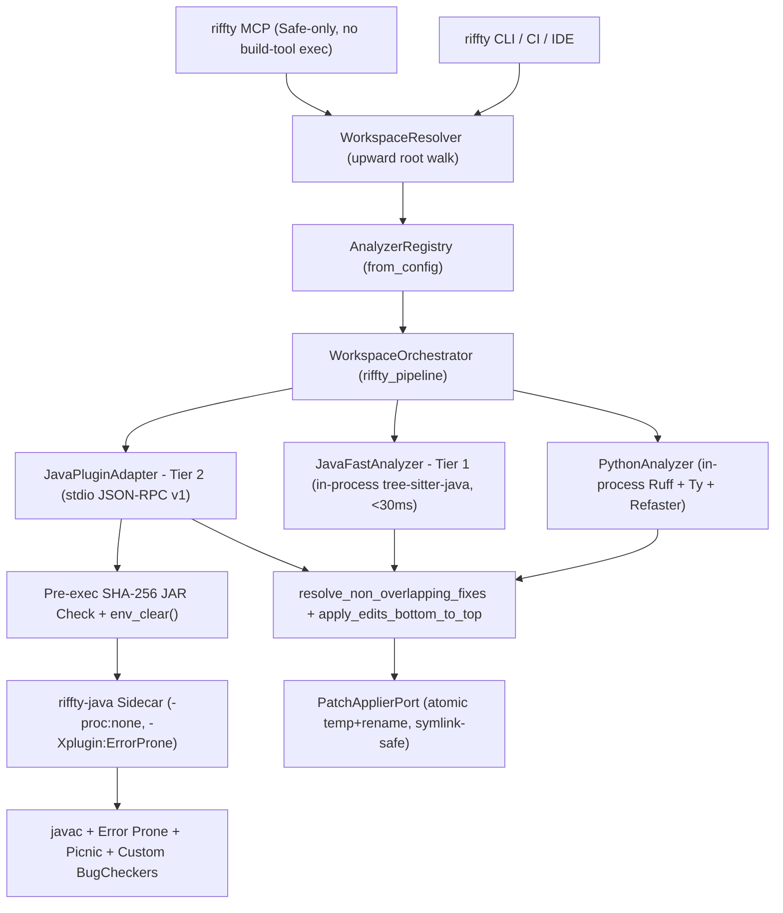

# RFC: Zero-Config Java Plugin Architecture for `riffty`

- **Status:** Draft — Ready for Rust & Java Language Expert Review
- **Target Repo:** `riffty` (`riffty-sh/riffty`)
- **Contributors:** Performance Architect, Code Elegance Architect, Security & Supply-Chain Architect, Java PO/PM & Enterprise Sales Lead, Principal DX Architect
- **Last Updated:** 2026-11-19

---

## 1. Executive Summary & Product Wedge

`riffty` is a deterministic, compiler-grade bug detector and surgical byte-offset auto-fixer with CLI (`riffty check --fix`, `--diff`) and MCP (`riffty mcp`) surfaces. This RFC specifies adding **zero-config Java support as a first-class plugin** that runs transparently across **terminal, IDE, CI/CD, and AI coding agents (MCP)** without requiring edits to `pom.xml`, `build.gradle`, or `build.gradle.kts`.

### Product Positioning ("Magic Moment")
Instead of competing with SonarQube on noisy warning counts or with OpenRewrite/Moderne on multi-month framework migrations, `riffty` for Java targets **Deterministic Code FinOps & Incident Prevention** — safely auto-fixing compiler-provable bugs that directly burn cloud compute/memory, cause OOM/FD outages, or introduce financial rounding errors:

- **Compute / GC Burn:** per-request `new ObjectMapper()`, `Pattern.compile()` / `String.replaceAll()` in hot paths, unpooled `HttpClient`/`OkHttpClient`, `String +=` in loops, wasteful `Stream.collect(toList()).isEmpty()`.
- **Leaks & Outage Risk:** unclosed `Files.walk()`/`Files.lines()`/`AutoCloseable`, non-atomic `ConcurrentHashMap` check-then-act stampedes.
- **Financial & Data Correctness:** `new BigDecimal(double)`, broken `equals()` without `hashCode()` (cache misses), ignored `Future`/`CompletableFuture` return values.

### Core Architectural Decisions (Cross-Functional Consensus)
1. **Two-Tier Execution:**
   - **Tier 1 (In-process Rust, `<30 ms`, zero JVM):** `tree-sitter-java` (`ast-grep-language`) for instant, locally provable syntactic fixes.
   - **Tier 2 (Out-of-process `riffty-java` sidecar, `<400 ms` warm / batch CI):** Hardened `javac` + Google Error Prone + Picnic `error-prone-support` + custom JRiffty `BugChecker`s for full type-resolved proofs.
2. **Coarse-Grained Hexagonal Seam:** Python's `NodeKind`, `CanonicalSyntaxTree`, and `CanonicalType` remain untouched. Languages integrate strictly at `LanguageAnalyzerPort` returning `riffty_core::Diagnostic` with UTF-8 byte-offset `Edit`s.
3. **Zero-RCE by Default:** Never execute `./mvnw`, `./gradlew`, `build.gradle(.kts)`, or user annotation processors (`-proc:none`) by default. Resolve classpaths statically from `target/classes`, `build/classes`, `pom.xml`, `~/.m2`, and `~/.gradle` (or explicit `--java-classpath`). Build-tool fallback requires `--allow-build-tool` and is **hard-disabled in `riffty mcp`**.
4. **Loud, Never-Silent Provenance:** Never silently degrade from Tier 2 to Tier 1. Emit compact tier/classpath provenance in `text`, `json`, `sarif`, and MCP payloads, and provide `--require-tier2` (exit code `2` on degradation) for fail-closed CI.

---

## 2. System Architecture & Data Flow



---

## 3. PART A — Detailed Rust Architecture *(For Rust Expert Review)*

### 3.1 Workspace Crate Topology

Add two focused adapter crates without bloating `riffty_core`:

```text
riffty/
├── crates/
│   ├── riffty_core/                 # Language, AnalysisProvenance, LineIndex, LanguageAnalyzerPort
│   ├── riffty_pipeline/             # WorkspaceOrchestrator, ReviewFacade, fixpoint, conflict resolution
│   ├── riffty_rules_builtin/        # Existing Python built-in rules (unchanged)
│   └── adapters/
│       ├── riffty_adapter_fs/       # Atomic PatchApplierPort, WorkspaceResolver, safe GitDiffPort
│       ├── riffty_adapter_ruff_ast/ # Python only (unchanged)
│       ├── riffty_adapter_ty/       # Python only (unchanged)
│       ├── riffty_adapter_ast_grep/ # Enable `tree-sitter-java` feature alongside `tree-sitter-python`
│       ├── riffty_adapter_refaster/ # Add `language: Language` field to RefasterRuleSpec
│       ├── riffty_adapter_java_fast/# NEW: Tier 1 zero-JVM Java rules (tree-sitter-java)
│       └── riffty_adapter_plugin/   # NEW: Out-of-process LanguageAnalyzerPort (stdio JSON-RPC v1 + SHA-256)
└── apps/
    ├── riffty_cli/                  # Thin CLI over AnalyzerRegistry + WorkspaceResolver + doctor/explain/dry-run
    └── riffty_mcp/                  # Thin MCP server over AnalyzerRegistry (hard-locked Safe + no build-tool)
```

### 3.2 Core Types & Trait Changes (`crates/riffty_core`)

Keep `NodeKind`, `CanonicalSyntaxTree`, `CanonicalType`, and `TypeOraclePort` untouched as Python-side internals. Add the following language-agnostic primitives to `riffty_core/src/lib.rs` and `riffty_core/src/ports.rs`:

```rust
// crates/riffty_core/src/lib.rs

#[derive(Debug, Clone, Copy, PartialEq, Eq, Hash, PartialOrd, Ord, Serialize, Deserialize)]
#[serde(rename_all = "snake_case")]
pub enum Language {
    Python,
    Java,
}

#[derive(Debug, Clone, Copy, PartialEq, Eq, Serialize, Deserialize)]
#[serde(rename_all = "snake_case")]
pub enum AnalysisTier {
    /// Full semantic/compiler-verified analysis (Ty for Python, javac+ErrorProne for Java).
    Tier2Semantic,
    /// Fast syntactic-only analysis (NullTypeOracle for Python, tree-sitter-java for Java).
    Tier1Syntactic,
}

#[derive(Debug, Clone, PartialEq, Eq, Serialize, Deserialize)]
pub struct AnalysisProvenance {
    pub language: Language,
    pub tier: AnalysisTier,
    pub files_analyzed: usize,
    /// e.g. Some("jdk 21 · 84 jars via target/classes")
    pub runtime_detail: Option<String>,
    /// Present whenever analysis ran below Tier2Semantic.
    pub degraded_reason: Option<String>,
    /// Actionable single-line recovery hint for CLI/MCP.
    pub remediation_hint: Option<String>,
}

/// Lightweight O(log N) byte-offset -> (1-based line, 1-based UTF-8 col) mapper
/// replacing redundant full-AST re-parses in `riffty_cli/src/main.rs:289`
/// and `riffty_pipeline/src/lib.rs:684`.
#[derive(Debug, Clone)]
pub struct LineIndex {
    /// Sorted byte offsets of line starts (always starts with 0).
    line_starts: Vec<u32>,
}

impl LineIndex {
    pub fn new(source: &str) -> Self { /* memchr '\n' scan */ }
    pub fn line_col(&self, offset: ByteOffset) -> (u32, u32) { /* partition_point */ }
    pub fn line_slice<'a>(&self, source: &'a str, line_1based: u32) -> &'a str { /* ... */ }
}
```

```rust
// crates/riffty_core/src/ports.rs

pub trait WorkspaceVfsPort: Send + Sync {
    /// Generalized extension-based workspace file discovery.
    fn discover_files(
        &self,
        root: &Path,
        extensions: &[&str],
    ) -> Result<Vec<WorkspaceFile>, String>;

    /// Backwards-compatible default delegating to `discover_files`.
    fn discover_python_files(&self, root: &Path) -> Result<Vec<WorkspaceFile>, String> {
        self.discover_files(root, &["py", "pyi"])
    }

    fn read_file(&self, path: &Path) -> Result<String, String>;
}

#[derive(Debug, Clone)]
pub struct AnalyzePassRequest<'a> {
    pub workspace_root: &'a Path,
    pub files: &'a [WorkspaceFile],
    /// Optional git-diff byte ranges per file; None => full file scope.
    pub scoped_ranges: Option<&'a HashMap<FileId, Vec<TextRange>>>,
    pub rules_paths: &'a [PathBuf],
    pub allow_unsafe: bool,
    pub pass_index: usize,
}

#[derive(Debug, Clone)]
pub struct AnalyzePassResponse {
    pub diagnostics: Vec<Diagnostic>,
    pub provenance: AnalysisProvenance,
}

/// Coarse-grained multi-language seam: 1 call per pass/batch, zero per-node IPC.
pub trait LanguageAnalyzerPort: Send + Sync {
    fn language(&self) -> Language;
    fn extensions(&self) -> &'static [&'static str];
    fn max_fixpoint_passes(&self) -> usize { 10 }

    /// Runs a single analysis pass over the provided in-memory file buffers.
    fn analyze_pass(&self, req: &AnalyzePassRequest<'_>) -> Result<AnalyzePassResponse, String>;

    /// Optional import manager (Python uses RuffImportAdapter; Java returns None
    /// because Error Prone emits explicit import Edits directly inside Fix::edits).
    fn import_manager(&self) -> Option<&dyn ImportManagerPort> { None }

    /// Optional reverse-dependent expansion for `--diff` mode.
    fn reverse_dependents(
        &self,
        _root: &Path,
        _touched: &[FileDiffRanges],
    ) -> Vec<FileDiffRanges> {
        Vec::new()
    }
}
```

### 3.3 `WorkspaceOrchestrator` & Fixpoint Semantics (`crates/riffty_pipeline`)

1. **Split `RifftyEngine` vs `WorkspaceOrchestrator`:**
   - Existing `RifftyEngine` becomes the internal engine wrapped by `PythonAnalyzer: LanguageAnalyzerPort`.
   - `WorkspaceOrchestrator` owns language partitioning, fixpoint convergence, `resolve_non_overlapping_fixes`, `apply_edits_bottom_to_top`, cycle detection (hashing per-file source via BLAKE3/SHA-256), `--diff` hunk filtering, and `dry_run` unified diff generation.
2. **Java Pass Cap & Incremental Pass 2:**
   - `JavaPluginAdapter::max_fixpoint_passes()` returns `2` (Error Prone already resolves non-overlapping fixes in Pass 1).
   - Pass 2 sends **only files modified in Pass 1** as in-memory buffers to `riffty-java`, avoiding redundant full-repo `javac` runs.
3. **Eliminate Existing Performance Redundancies:**
   - Remove the duplicate `oracle.index_workspace` invocation between `riffty_cli/src/main.rs:224` and `ReviewFacade` (`riffty_pipeline/src/lib.rs:620`).
   - Replace `SyntaxParserPort::parse` calls used solely for line/column display (`main.rs:289`, `lib.rs:684`) with `LineIndex`.

### 3.4 Upward `WorkspaceResolver` & Unified `AnalyzerRegistry`

Fix the single-file root bug in `riffty_cli/src/main.rs:181-186`:
- `WorkspaceResolver::resolve(target_path: &Path) -> ResolvedWorkspace` walks upward from `target_path` (or its parent if it is a file) until it finds the highest-priority marker:
  1. `riffty.toml`
  2. `settings.gradle` / `settings.gradle.kts` / root `pom.xml` (checking `<modules>` / parent POM)
  3. `.git`
  4. Fallback: `target_path` itself (or parent dir for a file).
- Both `riffty_cli` and `riffty_mcp` construct their pipeline via a single `AnalyzerRegistry::from_config(resolved, cli_or_mcp_policy)` so CLI, CI, IDE, and MCP never drift.

### 3.5 Hardened Subprocess & IPC Layer (`crates/adapters/riffty_adapter_plugin`)

1. **Pre-Exec Supply-Chain Verification:**
   - Embed a compile-time manifest of expected `(filename, sha256_hex)` pairs for the bundled `riffty-java` artifacts: the `jlink` **JDK 25 LTS** runtime marker, `riffty-java.aot` (Project Leyden AOT cache), and JARs (`riffty-java-runner.jar`, `error_prone_core.jar`, `error-prone-support.jar`, `riffty-java-rules.jar`).
   - Before every spawn, verify SHA-256 digests over every JAR and `.aot` file in the bundle directory; abort with exit code `2` on any mismatch or unexpected extra artifact.
2. **Process Isolation, Env Scrubbing & JDK 25 Performance Flags:**
   ```rust
   // Prefer bundled jlink JDK 25 LTS runtime (zero JAVA_HOME mismatch); fallback to validated system JDK 25+
   let mut cmd = Command::new(&bundle.bundled_java25_bin);
   cmd.env_clear();
   for key in ["PATH", "TMPDIR", "SystemRoot"] {
       if let Some(val) = std::env::var_os(key) {
           cmd.env(key, val);
       }
   }
   // Explicitly strips JAVA_HOME, JAVA_TOOL_OPTIONS, _JAVA_OPTIONS, JDK_JAVA_OPTIONS
   cmd.args([
       "-XX:+UseCompactObjectHeaders",               // JEP 519: 64-bit headers (~10-20% lower RSS for JCTree)
       &format!("-XX:AOTCache={}", bundle.aot_cache.display()), // JEP 483/514/515: fast cold boot
       "-XX:+UseSerialGC",                           // 1-shot CLI/CI mode (daemon mode uses -XX:+UseZGC)
       "-Xmx1g",
       "-XX:+ExitOnOutOfMemoryError",
   ]);
   ```
3. **Framing, Timeouts & Memory Bounds:**
   - Support `RIFFTY_JAVA_MAX_HEAP` override and enforce a strict wall-clock timeout (default `60s` per batch, `15s` for `--diff`).
   - Cap stdout payload size (e.g., `64 MiB`) to prevent OOM from pathological diagnostics; drain stderr on a dedicated reader thread/task so pipe buffers never deadlock.
   - Use newline-delimited JSON-RPC v1 over stdio in Milestone 2; the exact same transport trait (`PluginTransport`) supports a persistent Unix domain socket / Windows named pipe daemon in Milestone 3.

### 3.6 Pre-Java Security Fixes in Existing Rust Code (Milestone 0)

| File | Current Gap | Required Fix |
| :--- | :--- | :--- |
| [`apps/riffty_mcp/src/lib.rs`](file:///Users/jonatassouza/bin/dev/riffty-sh/riffty/apps/riffty_mcp/src/lib.rs#L217-L220) | Accepts arbitrary `workspace_root` from MCP client | Canonicalize and enforce `requested.starts_with(&default_root)` |
| [`crates/adapters/riffty_adapter_fs/src/lib.rs`](file:///Users/jonatassouza/bin/dev/riffty-sh/riffty/crates/adapters/riffty_adapter_fs/src/lib.rs#L139) | Passes `base_ref` directly into `git diff` | Reject leading `-`, NUL bytes, whitespace, or invalid ref chars; pass `--` separator |
| [`crates/adapters/riffty_adapter_fs/src/lib.rs`](file:///Users/jonatassouza/bin/dev/riffty-sh/riffty/crates/adapters/riffty_adapter_fs/src/lib.rs#L84-L118) | `fs::write` has TOCTOU symlink window | Check `symlink_metadata`, write to same-directory temp file (`tempfile::NamedTempFile::new_in`), `persist` atomically |

### 3.7 Questions for the Rust Language Expert
1. **Sync vs. Async Boundary:** `riffty_pipeline` is synchronous today while `riffty_mcp` runs on `tokio`. Should `LanguageAnalyzerPort::analyze_pass` remain synchronous (using `std::process::Command` + `tokio::task::spawn_blocking` inside `riffty_mcp`), or should `PluginTransport` use async I/O?
2. **Trait Objects vs. Enum Dispatch:** Given `Language` is a small closed set (`Python`, `Java`, future `TypeScript`/`Go`), is `Box<dyn LanguageAnalyzerPort>` preferable for plugin extensibility, or an internal `enum AnalyzerBackend`?
3. **Diagnostic Span Validation:** Should `WorkspaceOrchestrator` validate every incoming `Edit::range` from external plugins (`start <= end <= source.len()` and `source.is_char_boundary(start/end)`) and downgrade malformed edits to `ManualOnly` rather than failing the whole pass?
4. **Tier 1 + Tier 2 Deduplication:** When both Tier 1 (`tree-sitter-java`) and Tier 2 (`riffty-java`) run, should Tier 2 supersede Tier 1 completely for files that compiled cleanly, or should we merge and deduplicate by `(file_id, rule_id, range)`?

---

## 4. PART B — Detailed Java 25 LTS Architecture *(For Java Expert Review)*

### 4.1 Runtime, `jlink` Packaging & JDK 25 LTS Performance Stack (`riffty-java`)

`riffty-java` is built and executed natively on **Java 25 LTS** (compiled with `--release 25`), unlocking full `--release 8..25` target project analysis and JDK 25’s startup/memory/concurrency breakthroughs:

- **Zero-Config Bundled `jlink` JDK 25 Runtime:**
  - Ship a stripped-down `jlink` image containing *only* the modules needed for `javac` + Error Prone (`java.base`, `java.compiler`, `jdk.compiler`, `java.logging`, `java.xml`, `jdk.zipfs`, `jdk.unsupported`) with `--strip-debug --no-man-pages --no-header-files --compress=zip-6`.
  - **Why this matters:** Developers and CI runners still on JDK 8, 11, 17, or 21 run `riffty-java` with **zero `JAVA_HOME` setup and zero version-mismatch errors**, while still analyzing Java 8–25 repositories via `javac --release <N>`.
- **Project Leyden AOT Cache (`-XX:AOTCache`, JEP 483 / JEP 514 / JEP 515):**
  - During release CI, run a deterministic training pass (`-XX:AOTCacheOutput=riffty-java.aot`) compiling representative Spring Boot / Java 25 fixtures through `javac` + Error Prone + Picnic.
  - Ship the SHA-256-verified `riffty-java.aot` alongside the `jlink` image. Cold-start class loading, linking, and method profiles are pre-baked, cutting 1-shot CLI/CI startup latency by **2–3×** without GraalVM native-image incompatibilities with `jdk.compiler`.
- **Compact Object Headers (`-XX:+UseCompactObjectHeaders`, JEP 519):**
  - Reduces object headers to 64 bits across `javac`’s dense `JCTree` ASTs, symbol tables, and Error Prone matchers — cutting RSS memory by ~10–20% and improving L2/L3 cache locality.
- **Mode-Specific GC Strategy:**
  - **1-shot CLI / CI:** `-XX:+UseSerialGC` + `-XX:+UseCompactObjectHeaders` (minimal thread/startup tax).
  - **Warm 15-min Daemon (Milestone 3):** `-XX:+UseZGC` (Generational ZGC) + `-XX:+UseCompactObjectHeaders` for sub-millisecond pause times during interactive IDE/MCP edits.
- **Offline Supply-Chain Bundle (with CycloneDX SBOM):**
  - `runtime/` (minimal `jlink` JDK 25 LTS image)
  - `riffty-java.aot` (SHA-256-pinned Leyden AOT cache matching `runtime/`)
  - `riffty-java-runner.jar` (JSON-RPC v1 stdio/daemon runner + `JavacTask` harness + `DescriptionListener`)
  - `error_prone_core-<ver>.jar` + transitive deps (shaded to avoid classpath collisions with target projects)
  - `error-prone-support-<ver>.jar` (Picnic Refaster & BugCheckers)
  - `riffty-java-rules-<ver>.jar` (custom money-saving `BugChecker`s)

### 4.2 Concurrency & Context Isolation: Pin-Free Virtual Threads (JEP 491) + `ScopedValue` (JEP 506)

Multi-module Maven/Gradle repos and warm daemon requests run concurrently using **Java 25 pin-free Virtual Threads** (`Executors.newVirtualThreadPerTaskExecutor()` — JEP 491 eliminates `synchronized` carrier-thread pinning inside `javac`/ZIP I/O) paired with **`ScopedValue`** (finalized in Java 25, JEP 506) instead of `ThreadLocal`:

```java
public record RequestContext(
    String requestId,
    Path workspaceRoot,
    int targetRelease,
    boolean allowUnsafe,
    Instant deadline
) {}

public final class RifftyRuntimeContext {
    public static final ScopedValue<RequestContext> CURRENT = ScopedValue.newInstance();
}

// Bound per request / per module task — strictly immutable, zero ThreadLocal leaks in daemon mode:
ScopedValue.where(RifftyRuntimeContext.CURRENT, ctx)
    .call(() -> analyzeModuleBatch(request));
```

### 4.3 Modern Java 25 Domain Modeling (Sealed Types, Record Patterns, Flexible Constructors)

Model the JSON-RPC protocol and diagnostic IR with zero boilerplate and compile-time exhaustiveness using Java 25 language features:

```java
public sealed interface PluginCommand permits AnalyzePassCmd, ShutdownCmd, HealthCheckCmd {}

public record TextRange(int start, int end) {
    // JEP 513 (Flexible Constructor Bodies, final in Java 25) / compact constructor invariant:
    public TextRange {
        if (start < 0 || end < start) {
            throw new IllegalArgumentException("Invalid UTF-8 TextRange: [%d, %d)".formatted(start, end));
        }
    }
}

public enum Applicability { Safe, Unsafe, ManualOnly }
public enum Severity { Error, Warning, Info }

public record Edit(TextRange range, String replacement) {}
public record Fix(String title, List<Edit> edits, List<Object> required_imports, Applicability applicability) {}
public record Diagnostic(
    String rule_id,
    String rule_name,
    Severity severity,
    int file_id,
    TextRange range,
    String message,
    Map<String, Object> type_proof,
    Fix fix
) {}
```

Dispatch commands cleanly with exhaustive pattern matching (`switch` + record patterns) and unnamed variables (`_`, JEP 456) for ignored exception details or unused destructured fields.

### 4.4 Programmatic `javac` + Error Prone Harness (No In-Place Patching)

Do **not** invoke Error Prone via `-XepPatchLocation:IN_PLACE` (unsafe write boundary, no unified conflict resolution with `riffty_pipeline`, no `--dry-run`). Drive `javac` programmatically via `javax.tools.JavaCompiler` and capture `Description` objects directly:

```java
// Conceptual core inside riffty-java-runner (Java 25 LTS)

JavaCompiler compiler = ToolProvider.getSystemJavaCompiler();
try (StandardJavaFileManager stdFm =
        compiler.getStandardFileManager(null, Locale.ROOT, StandardCharsets.UTF_8);
     JavaFileManager overlayFm =
        new InMemoryOverlayFileManager(stdFm, request.inMemoryBuffers())) {

    List<String> options = List.of(
        "-proc:none",                      // CRITICAL: never execute target repo annotation processors
        "-implicit:none",                  // avoid compiling transitive untouched sources
        "-Xlint:none",                     // suppress standard javac noise
        "-XDcompilePolicy=simple",         // required by Error Prone
        "-Xmaxerrs", "500",
        "-d", ephemeralTempDir.toString(), // bytecode never pollutes target/ or build/
        "--release", String.valueOf(detectedRelease), // 8..25 supported natively on JDK 25 host
        "-classpath", resolvedClasspath,
        "-processorpath", verifiedRifftyBundleClasspath,
        "-Xplugin:ErrorProne " + errorProneFlags(request)
    );
    // ... attach DescriptionListener / ErrorProneScannerTransformer & invoke task.call()
}
```

**Required JVM `--add-exports` / `--add-opens` (passed by Rust when launching `riffty-java` on JDK 25):**
```text
--add-exports=jdk.compiler/com.sun.tools.javac.api=ALL-UNNAMED
--add-exports=jdk.compiler/com.sun.tools.javac.file=ALL-UNNAMED
--add-exports=jdk.compiler/com.sun.tools.javac.main=ALL-UNNAMED
--add-exports=jdk.compiler/com.sun.tools.javac.model=ALL-UNNAMED
--add-exports=jdk.compiler/com.sun.tools.javac.parser=ALL-UNNAMED
--add-exports=jdk.compiler/com.sun.tools.javac.processing=ALL-UNNAMED
--add-exports=jdk.compiler/com.sun.tools.javac.tree=ALL-UNNAMED
--add-exports=jdk.compiler/com.sun.tools.javac.util=ALL-UNNAMED
--add-opens=jdk.compiler/com.sun.tools.javac.code=ALL-UNNAMED
--add-opens=jdk.compiler/com.sun.tools.javac.comp=ALL-UNNAMED
```

### 4.5 Zero-Dependency Bytecode Inspection via Standard Class-File API (JEP 484)

Java 25 includes the finalized **`java.lang.classfile.ClassFile`** API in `java.base` — eliminating any need to bundle ASM for read-only bytecode inspection:

- **Target Release Auto-Detection:** Read the major classfile version from existing `target/classes` / `build/classes` in microseconds when `pom.xml`/`build.gradle` omits explicit `<maven.compiler.release>`.
- **Lombok & Generated-Code Awareness:** Inspect compiled `.class` files in `target/classes` via `ClassFile.of().parse(path)` to verify whether a class contains Lombok-generated synthetic members or `@Generated` annotations, allowing accurate `AnalysisProvenance` warnings without running Lombok's annotation processor.
- **Fast Subtype / Annotation Indexing:** Pre-scan compiled project classes (e.g., Spring `@Bean` factory methods or `AutoCloseable` subtypes) to enrich `type_proof` metadata and suppress false positives on DI-managed beans.

### 4.6 Extracting `SuggestedFix` & Exact UTF-16 → UTF-8 Byte-Offset Mapping

`javac` and Error Prone report `Replacement` positions as **UTF-16 `char` indices** (`com.google.errorprone.fixes.Replacement`), whereas `riffty_core::TextRange` operates strictly on **UTF-8 byte offsets**.

Inside `riffty-java`, build a one-time O(N) lookup table per analyzed file (using `Math.clamp` and JEP 513 invariant checks):

```java
final class Utf16ToUtf8Index {
    // utf8Offset[utf16Index] = corresponding UTF-8 byte offset in source.getBytes(UTF_8)
    private final int[] utf8Offset;

    Utf16ToUtf8Index(String source) {
        Objects.requireNonNull(source, "source");
        int n = source.length();
        this.utf8Offset = new int[n + 1];
        int bytePos = 0;
        for (int i = 0; i < n; ) {
            utf8Offset[i] = bytePos;
            int cp = source.codePointAt(i);
            int charCount = Character.charCount(cp); // 1 or 2 (surrogate pair)
            int utf8Len = utf8ByteLength(cp);        // 1, 2, 3, or 4
            if (charCount == 2) {
                utf8Offset[i + 1] = bytePos;
            }
            bytePos += utf8Len;
            i += charCount;
        }
        utf8Offset[n] = bytePos;
    }

    int toByteOffset(int utf16Pos) {
        return utf8Offset[Math.clamp(utf16Pos, 0, utf8Offset.length - 1)];
    }

    private static int utf8ByteLength(int cp) {
        if (cp <= 0x7F) return 1;
        if (cp <= 0x7FF) return 2;
        if (cp <= 0xFFFF) return 3;
        return 4;
    }
}
```

For each Error Prone `Description`:
1. Take the first safe `SuggestedFix` (only if the rule is on `riffty`’s `Applicability.Safe` allowlist).
2. Convert `SuggestedFix` into concrete `Set<Replacement>` via `fix.getReplacements(endPosTable)` — **which already includes import insertions/removals** calculated by Error Prone's `ImportOrganizer` (configured to preserve existing import style and avoid Spotless/Checkstyle churn).
3. Translate each `Replacement(startChar, endChar, replaceWith)` into `Edit(new TextRange(startByte, endByte), replaceWith)`.
4. Populate `type_proof` with structured JSON (resolved FQN, receiver type, mutating-call analysis result) for deterministic audit logs.

### 4.7 Custom "Money-Saving" `BugChecker` Blueprint (Example: `PerCallObjectMapperHoist`)

To guarantee **0% false positives on `--fix`**, custom rules prove safety via `javac` types and local dataflow:

1. **Match:** `NewClassTree` inside a non-static initializer / non-`<clinit>` method where `ASTHelpers.isSameType(type, "com.fasterxml.jackson.databind.ObjectMapper", state)`.
2. **Escape & Mutation Guard (for `Applicability.Safe`):**
   - Verify the `ObjectMapper` local variable is **not** returned from the method, **not** stored in a non-final field, and **not** passed to any method that mutates it.
   - Scan all usages of the `VarSymbol` in the enclosing block: allow only known thread-safe read/write methods (`readValue`, `writeValueAsString`, `writeValueAsBytes`, `readTree`, `convertValue`, `valueToTree`, `treeToValue`, `readerFor`, `writerFor`).
   - Downgrade to `Applicability.ManualOnly` if any mutator is called (`configure`, `enable`, `disable`, `registerModule`, `setDateFormat`, `setSerializationInclusion`, `setPropertyNamingStrategy`, etc.) or if the enclosing tree contains `TypeKind.ERROR`.
3. **Deterministic Fix:**
   - Insert `private static final ObjectMapper RIFFTY_OBJECT_MAPPER = new ObjectMapper();` at top of enclosing class (reusing an existing stateless `static final ObjectMapper` field if present).
   - Replace `new ObjectMapper()` expression with `RIFFTY_OBJECT_MAPPER`.

### 4.8 Native Java Suppressions

Support both styles seamlessly so Java engineers never fight IntelliJ or Checkstyle:
- `@SuppressWarnings("riffty:JAVA-OBJMAP-001")` or `@SuppressWarnings("riffty")` (handled natively via Error Prone's `altNames` / custom suppression matcher on enclosing AST nodes).
- `// riffty: ignore[JAVA-OBJMAP-001] -- custom per-request config` (handled uniformly by `riffty_core`'s `LineIndex` suppression extractor).

### 4.9 Classpath Ladder & Generated-Code Caveat (Lombok / MapStruct)

- **Level 0 (Default, Zero RCE):**
  1. Scan `target/classes`, `target/test-classes`, `build/classes/java/main` (if already compiled).
  2. Statically parse `pom.xml` / `gradle.lockfile` / `.classpath` in Rust and map coordinates to read-only `~/.m2/repository` and `~/.gradle/caches/modules-2/files-2.1`.
  3. Accept explicit `--java-classpath <path>` / `RIFFTY_JAVA_CLASSPATH` from trusted CI.
- **Level 1 (Opt-in `--allow-build-tool`, hard-disabled in MCP):**
  - Run `mvn -q -o dependency:build-classpath -Dmdep.outputFile=...` or Gradle `--init-script` (offline-first), caching the result in `.riffty/cache/java-cp-<sha256>.json`.
- **Lombok / MapStruct / Annotation-Generated Code Handling:**
  - Because `-proc:none` disables user annotation processors for security, source files using Lombok (`@Data`, `@Slf4j`, `@Builder`) or MapStruct may have unresolved synthetic methods (`getFoo()`, `log.info(...)`) unless compiled bytecode (`target/classes`) is present.
  - **Mitigation:**
    1. When `target/classes` exists, cross-file Lombok methods resolve from compiled `.class` files on `-classpath`, and `java.lang.classfile.ClassFile` detects Lombok-compiled bytecode to inform `AnalysisProvenance`.
    2. For intra-file Lombok symbols when `-proc:none` triggers `compiler.err.cant.resolve.location`, **any rule whose AST subtree contains `TypeKind.ERROR` MUST downgrade to `ManualOnly` (never emit `Applicability.Safe` fixes on unresolved symbols)**.

### 4.10 Declarative Architecture Guardrails *(Native Alternative to ArchUnit & Semgrep)*

`riffty` intentionally does **not** embed Semgrep (redundant with `ast-grep`, LGPL-2.1/competitor risk, runtime bloat) or ArchUnit (bytecode-only, JUnit-coupled, no source `TextRange` spans). Instead, in **Milestone 3 (Enterprise)**, `riffty` provides **zero-extra-JAR declarative architecture rules** directly in `riffty.toml`:

```toml
[[java.architecture.forbid]]
id = "ARCH-DOMAIN-001"
from = "com.acme.domain.**"
target = ["org.springframework.**", "jakarta.persistence.**"]
message = "Domain layer must stay framework-free"

[[java.architecture.forbid]]
id = "ARCH-LAYER-002"
from = "com.acme.adapter.inbound.**"
target = ["com.acme.adapter.outbound.repository.**"]
message = "Inbound controllers must not bypass application use-cases to call repositories directly"
```

- **How it works (Source + Bytecode Hybrid):**
  1. **Uncompiled edits / IDE / `riffty mcp`:** Enforced directly on `javac` `ImportTree` + resolved symbol types (`MemberSelectTree` / `IdentifierTree`), producing exact source `TextRange` codeframes — blocking AI coding agents from violating hexagonal/layered boundaries *before* code is even compiled.
  2. **Transitive / Compiled Verification:** Augmented with Java 25’s built-in `java.lang.classfile.ClassFile` API (JEP 484) to detect indirect/binary-level dependency leaks and package cycles across compiled modules without adding ArchUnit or ASM JARs.
- **Cross-Language Consistency:** Uses the exact same `[[<lang>.architecture.forbid]]` schema for both Python and Java.

### 4.11 Questions for the Java 25 Language Expert
1. **Error Prone & Picnic on JDK 25 `javac` Internals:** Are there any breaking `com.sun.tools.javac.*` AST/symbol changes in JDK 25 LTS affecting Error Prone (`2.36+`) or Picnic `error-prone-support` (`--add-exports` / `BaseErrorProneJavaCompiler` / `DescriptionListener`), and is extending `ErrorProneScannerTransformer` inside a custom `JavacTask` `TaskListener` cleaner than hooking `ErrorPronePlugin`?
2. **Project Leyden AOT Cache (`-XX:AOTCache`) Stability:** Because `riffty-java` passes `--add-exports` and dynamically compiles arbitrary target classpaths via `ToolProvider.getSystemJavaCompiler()`, does a pre-trained `riffty-java.aot` cache remain valid across varying `-classpath` arguments (as long as the `riffty-java` boot/application classpath and JVM flags match), and what is the expected cold-start speedup vs. `jlink` bundle size?
3. **Lombok & `-proc:none` Trade-off:** In Spring Boot enterprise repos (60%+ Lombok), how severely does `-proc:none` degrade Error Prone type resolution on *currently edited* files? Should we pair `java.lang.classfile` Lombok detection with an explicit SHA-256-pinned Lombok-only opt-in mode, or stay strictly `-proc:none`?
4. **Virtual Threads + `JavacTask` Reuse in Daemon Mode (Milestone 3):** Does running parallel module `JavacTask`s on JDK 25 Virtual Threads with `StandardJavaFileManager` JAR zip-index caching stay leak-free and thread-safe, or should each request allocate a fresh `JavacFileManager` while keeping only the JVM + AOT/JIT + `BugChecker` metadata warm?
5. **Import Formatting Compatibility:** Error Prone's `ImportOrganizer` can reorder or wildcard-expand imports differently from Google Java Format / Spotless / Checkstyle. What is the safest configuration (`ImportOrganizer.EMPTY` vs. surgical single-line insertion) to guarantee zero formatting churn?

---

## 5. PART C — Wire Protocol Specification (JSON-RPC v1 over stdio)

One newline-delimited JSON object per request/response on `stdin`/`stdout` (`stderr` reserved exclusively for structured debug logs):

### Request (`riffty` → `riffty-java`)
```json
{
  "protocol": 1,
  "id": "pass-0",
  "workspace_root": "/abs/path/to/repo",
  "jdk_release": 25,
  "classpath": ["/Users/dev/.m2/repository/.../jackson-databind-2.17.2.jar"],
  "files": [
    {
      "file_id": 1,
      "relative_path": "src/main/java/com/acme/OrderController.java",
      "source": "package com.acme;\n..."
    }
  ],
  "scoped_ranges": {
    "1": [{ "start": 412, "end": 890 }]
  },
  "enabled_rules": ["JAVA-OBJMAP-001", "EP-BigDecimalLiteralDouble", "EP-StreamResourceLeak"],
  "custom_rules_paths": [],
  "allow_unsafe": false
}
```

### Response (`riffty-java` → `riffty`)
```json
{
  "protocol": 1,
  "id": "pass-0",
  "provenance": {
    "language": "java",
    "tier": "tier2_semantic",
    "files_analyzed": 1,
    "runtime_detail": "jdk 25 (bundled jlink · aot) · 84 jars via target/classes",
    "degraded_reason": null,
    "remediation_hint": null
  },
  "diagnostics": [
    {
      "rule_id": "JAVA-OBJMAP-001",
      "rule_name": "per-call-object-mapper",
      "severity": "Warning",
      "file_id": 1,
      "range": { "start": 524, "end": 542 },
      "message": "Stateless `new ObjectMapper()` allocated inside request method; hoist to `private static final` to avoid per-call reflection/GC overhead.",
      "type_proof": {
        "fqn": "com.fasterxml.jackson.databind.ObjectMapper",
        "mutating_calls": 0,
        "escapes_method": false
      },
      "fix": {
        "title": "Hoist stateless ObjectMapper to private static final field",
        "edits": [
          { "range": { "start": 180, "end": 180 }, "replacement": "    private static final ObjectMapper RIFFTY_OBJECT_MAPPER = new ObjectMapper();\n\n" },
          { "range": { "start": 524, "end": 542 }, "replacement": "RIFFTY_OBJECT_MAPPER" }
        ],
        "required_imports": [],
        "applicability": "Safe"
      }
    }
  ]
}
```

---

## 6. PART D — Top 10 Money-Saving Rules, DX Contract & Delivery Plan

### Top 10 Initial Java Rules

| # | Rule ID | Money Leak | Engine / Tier | Default `--fix` |
| :--- | :--- | :--- | :--- | :--- |
| 1 | `JAVA-OBJMAP-001` | Per-call `new ObjectMapper()` CPU/GC burn | Tier 2 custom `BugChecker` (Tier 1 detect) | `Safe` (when proven stateless) |
| 2 | `JAVA-REGEX-001` | `Pattern.compile` / `replaceAll` in hot loops | Tier 1 + Tier 2 Picnic Refaster | `Safe` |
| 3 | `JAVA-HTTP-001` | Unpooled `HttpClient` / `OkHttpClient` per call | Tier 2 custom `BugChecker` | `Safe` (default client) / `ManualOnly` |
| 4 | `JAVA-STR-001` | `String +=` inside loops ($O(n^2)$ GC churn) | Tier 2 local-flow `BugChecker` | `Safe` |
| 5 | `EP-StreamCollect` | `stream().collect(toList()).isEmpty()`, `size()==0` | Tier 2 Picnic `error-prone-support` | `Safe` |
| 6 | `EP-StreamResourceLeak` | Unclosed `Files.walk` / `Files.lines` / streams | Tier 1 + Tier 2 Error Prone | `Safe` (`try-with-resources`) |
| 7 | `JAVA-CHM-001` | Non-atomic `ConcurrentHashMap` check-then-act | Tier 2 Picnic Refaster + custom | `Safe` (pure RHS) / `Unsafe` |
| 8 | `EP-BigDecimalDouble` | `new BigDecimal(double)` billing/rounding bug | Tier 1 + Tier 2 Error Prone | `Safe` |
| 9 | `EP-EqualsHashCode` | `equals()` without `hashCode()` (100% cache miss) | Tier 2 Error Prone | `ManualOnly` / `Unsafe` |
| 10 | `EP-FutureIgnored` | Ignored `Future` / `CompletableFuture` exceptions | Tier 2 Error Prone | `ManualOnly` |

### DX Contract
- **CLI Commands:** `riffty check .`, `riffty check --fix --dry-run`, `riffty check --fix`, `riffty check --diff --base-ref main`, `riffty check --require-tier2 --format sarif --summary`, `riffty explain <RULE>`, `riffty doctor`, `riffty mcp`.
- **Exit Codes:** `0` = clean, `1` = findings (or pending fixes in `--dry-run`), `2` = configuration / environment error (including `--require-tier2` degradation or SHA-256 bundle failure).

### Phased Delivery Milestones
- **Milestone 0 (2–3 days):** Security hardening (`riffty_mcp` containment, `base_ref` validation, atomic `write_patched_file`), upward `WorkspaceResolver`, `LineIndex`, `LanguageAnalyzerPort`, `AnalyzerRegistry`, and `--fix --dry-run`.
- **Milestone 1 (Weeks 1–3):** `riffty_adapter_java_fast` (Tier 1 `tree-sitter-java`), 8–10 core rules, `riffty explain`, `riffty doctor`, `--format sarif`, `--summary`, and `AnalysisProvenance`.
- **Milestone 2 (Weeks 4–6):** `riffty-java` Tier 2 sidecar (hardened `javac` + SHA-256-pinned Error Prone + Picnic + custom `ObjectMapper`/`HttpClient` checkers, UTF-16→UTF-8 mapper, max 2 fixpoint passes, `--require-tier2`), bundled in Homebrew/tarball/GitHub Action.
- **Milestone 3 (Months 2–3):** Warm 15-min JVM daemon over the same JSON-RPC v1 protocol, **declarative `riffty.toml` architecture guardrails** (`[[java.architecture.forbid]]` via `javac` imports/types + Java 25 `java.lang.classfile.ClassFile` API, active in CLI/CI/`riffty mcp` without embedding ArchUnit or Semgrep), custom Java YAML Refaster rule packs (Spring Boot 3, Kafka, AWS SDK v2, Hibernate), and Enterprise FinOps & fleet automation.

