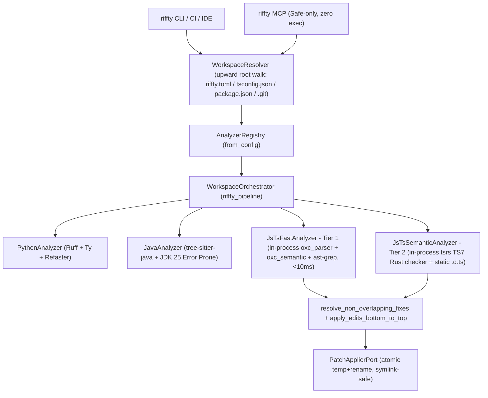

# RFC: Zero-Config JavaScript / TypeScript Plugin Architecture for `riffty`

- **Status:** Draft — Ready for Execution (Milestones 0–3)
- **Target Repo:** `riffty` (`riffty-sh/riffty`)
- **Validation Repo:** `riffty-assets` (`benchmarks/jsts_milestones_tests/`)
- **Precedent:** [`RFC_JAVA_PLUGIN_ARCHITECTURE.md`](./RFC_JAVA_PLUGIN_ARCHITECTURE.md)
- **Last Updated:** 2026-11-20

---

## 1. Executive Summary & Product Wedge

`riffty` is a deterministic, compiler-grade bug detector and surgical UTF-8 byte-offset auto-fixer with CLI (`riffty check --fix`, `--diff`, `--require-tier2`) and MCP (`riffty mcp`) surfaces. This RFC specifies adding **zero-config JavaScript & TypeScript support as a first-class, pure-Rust, in-process plugin**—the exact JS/TS equivalent of Python’s `ruff` + `ty` architecture.

### Why Pure-Rust In-Process (Zero Node.js, Zero RCE)
Unlike ESLint + `typescript-eslint` (which requires Node.js, runs slow single-threaded JS `tsc`, and executes arbitrary user JS via `eslint.config.js`), `riffty` embeds:
- **Tier 1 (`<10 ms`, zero `tsconfig`, zero `node_modules`):** `oxc_parser` + `oxc_ast` + `oxc_semantic` (MIT, pure Rust) + `ast-grep` (`TypeScript` / `Tsx` / `JavaScript` grammars) for instant, locally provable syntactic & scope-aware fixes.
- **Tier 2 (Full TypeScript 7 Semantic Proof, pure Rust in-process):** `oxc-project/tsrs` (`tsrs_checker` / `tsrs_lint`, Apache-2.0 Rust port of TypeScript 7 `tsgo`) reading `tsconfig.json` and static `node_modules/**/*.d.ts` directly from disk.
  - **Fallback Option:** Because everything sits behind `LanguageAnalyzerPort`, Microsoft’s native Go `tsgo` binary can remain an optional drop-in backend without touching `riffty_core` or `riffty_pipeline`.
  - **Explicitly Excluded:** Biome 2.0 (`Biotype`) is excluded from Tier 2 because its approximate type inference (~75% coverage on rules like `no-floating-promises`) violates `riffty`’s fail-closed compiler-grade determinism guarantee.

### Product Positioning ("Magic Moment" — JS/TS Code FinOps & Incident Prevention)
- **Outages & Silent Failures:** Floating promises (`no-floating-promises`), `async` promise executors (`new Promise(async ...)`), misused promises in conditionals, unclosed streams / `AbortController` / timer handles.
- **Financial & Data Corruption:** `number[].sort()` without numeric comparator (lexicographic sort bug: `[10, 2].sort()` -> `[10, 2]`), `JSON.parse(JSON.stringify(x))` dropping `Date`/`Map`/`Set`/`undefined` while burning CPU/GC (`structuredClone`), `NaN` / `-0` equality traps.
- **Cloud & AI Compute FinOps:** Per-request `new OpenAI()`, `new Anthropic()`, `new S3Client()`, `new PrismaClient()` inside handlers/loops; `new RegExp(...)` / `new Intl.DateTimeFormat(...)` allocated inside hot loops; sequential `await` in loops over independent I/O.
- **Architecture Guardrails:** Declarative `[[jsts.architecture.forbid]]` in `riffty.toml` blocking layer/boundary leaks (e.g., UI components importing DB/server modules, domain layer importing Next.js/Express) in CLI, CI, and `riffty mcp` with zero extra runtime.

---

## 2. System Architecture & Data Flow



### Unified `Language::JsTs` Design Decision
In real TypeScript repositories (`allowJs: true`, mixed `.ts`/`.tsx`/`.js`/`.jsx` packages, monorepos), `.ts` files import `.js` files and vice versa within the same `tsconfig.json` program. Partitioning them into separate `Language` passes would break cross-file type resolution. Therefore:
- Add **`Language::JsTs`** (`as_str() => "jsts"`) covering extensions: `["ts", "tsx", "mts", "cts", "js", "jsx", "mjs", "cjs"]`.
- `WorkspaceResolver` recognizes `tsconfig.json`, `jsconfig.json`, `pnpm-workspace.yaml`, `turbo.json`, and `package.json` (with `workspaces`) as workspace root markers (lower priority than `riffty.toml`, higher than `.git`).

### Crate Topology (`riffty/`)
```text
riffty/crates/
├── riffty_core/                      # Add Language::JsTs; keep NodeKind/CanonicalType untouched
├── riffty_pipeline/                  # Reuse WorkspaceOrchestrator, fixpoint, conflict resolution
└── adapters/
    ├── riffty_adapter_ast_grep/      # Enable TypeScript, Tsx, JavaScript languages
    ├── riffty_adapter_refaster/      # Support `language: jsts` in YAML Refaster rules
    ├── riffty_adapter_jsts_fast/     # NEW (M1): Tier 1 in-process oxc_parser + oxc_semantic + OxcImportAdapter
    └── riffty_adapter_tsrs/          # NEW (M2): Tier 2 in-process tsrs (TS7 Rust type checker) + arch guardrails (M3)
```

---

## 3. Zero-RCE Security, Fail-Closed Safety & Provenance Contract

1. **Zero-RCE by Default (Hard Invariant):**
   - Never execute `node`, `npm`, `pnpm`, `yarn`, `bun`, `npx`, `tsc`, or evaluate `eslint.config.*`, `vite.config.*`, `next.config.*`, or `package.json` scripts.
   - Read `tsconfig.json` (JSONC), `package.json` (static JSON), and `node_modules/**/*.d.ts` strictly as read-only files via Rust filesystem APIs.
2. **Fail-Closed Type Semantics:**
   - Any expression whose resolved type is `any`, `error`, or unresolved (missing `node_modules` / uninstalled `@types/*` / Yarn PnP virtual archive) MUST evaluate to `TriState::Unknown` and **never** emit `Applicability::Safe` fixes for type-dependent rules (downgrade to `ManualOnly` or skip).
   - Native suppressions supported uniformly: `// riffty: ignore[JSTS-SORT-001] -- reason` via `LineIndex`.
3. **Loud, Never-Silent Provenance:**
   - Tier 2 healthy: `tier2_semantic` — `runtime_detail: "tsrs (TS7 Rust) · tsconfig.json · N @types packages"`.
   - Tier 1 degraded (e.g., no `tsconfig.json` or `node_modules` absent): `tier1_syntactic` — `degraded_reason: "node_modules not installed; type-dependent rules skipped"` + `remediation_hint: "run npm ci --ignore-scripts (or pnpm install --ignore-scripts)"`.
   - `--require-tier2` MUST exit with code `2` whenever JS/TS files degrade to Tier 1.

---

## 4. Initial Rule Catalog (Deterministic FinOps & Incident Prevention)

| # | Rule ID | Bug / Money Leak | Tier | Default `--fix` |
| :--- | :--- | :--- | :---: | :--- |
| 1 | `JSTS-PROMISE-EXEC-001` | `new Promise(async (resolve, reject) => ...)` swallows rejections / anti-pattern | Tier 1 (`oxc_semantic`) | `ManualOnly` / `Safe` (simple wrapper) |
| 2 | `JSTS-REGEX-LOOP-001` | `new RegExp("literal", "g")` allocated inside `for`/`while`/`map`/`filter` loop | Tier 1 (`oxc_semantic`) | `Safe` (hoist module/outer `const`) |
| 3 | `JSTS-INTL-LOOP-001` | `new Intl.DateTimeFormat(...)` / `NumberFormat` allocated inside hot loop | Tier 1 (`oxc_semantic`) | `Safe` (hoist `const`) |
| 4 | `JSTS-CLONE-001` | `JSON.parse(JSON.stringify(x))` CPU/GC burn & data loss | Tier 1 (`oxc_semantic`) | `Safe` (`structuredClone(x)`, guarded) |
| 5 | `JSTS-NAN-EQ-001` | `x === NaN` / `x !== NaN` (always `false` / `true`) | Tier 1 (`oxc_semantic`) | `Safe` (`Number.isNaN(x)`) |
| 6 | `JSTS-DUP-AWAIT-001` | Redundant `return await` outside `try` or `await` on non-thenable literal | Tier 1 (`oxc_semantic`) | `Safe` |
| 7 | `JSTS-FLOAT-PROMISE-001` | Unhandled floating `Promise<T>` expression statement (`no-floating-promises`) | Tier 2 (`tsrs`) | `ManualOnly` (or `Safe` `void ` when explicitly configured) |
| 8 | `JSTS-NUM-SORT-001` | `arr.sort()` where `arr` is proven `number[]` / `readonly number[]` (lexicographic corruption!) | Tier 2 (`tsrs`) | `Safe` (`arr.sort((a, b) => a - b)`) |
| 9 | `JSTS-MISUSED-PROMISE-001` | `if (asyncFn())` where condition is proven `Promise<T>` (always truthy!) | Tier 2 (`tsrs`) | `Safe` (`if (await asyncFn())` inside `async fn`) / `ManualOnly` |
| 10 | `JSTS-SDK-CLIENT-001` | Per-request `new OpenAI()` / `new Anthropic()` / `new S3Client()` / `new PrismaClient()` inside handler | Tier 2 (`tsrs`) | `Safe` (stateless hoist) / `ManualOnly` |
| 11 | `JSTS-AWAIT-LOOP-001` | Independent `await` calls inside loop over array (serial network waterfall) | Tier 2 (`tsrs`) | `ManualOnly` (with `Promise.all` guidance) |
| 12 | `JSTS-ARCH-FORBID` | Declarative `[[jsts.architecture.forbid]]` module/import boundary violation | Tier 2 (`tsrs` + `oxc`) | Detect-only (`Error` in SARIF/CLI/MCP) |

---

## 5. Mandatory Milestone Gate Protocol (Zero-Assumption Governance)

**Every milestone (M0, M1, M2, M3) MUST pass the following 5-step gate in strict order before it can be marked DONE:**

1. **Step A — 100% Deterministic Requirements Checklist Audit (Pre-OSS Gate):**
   - Walk through **every single `REQ-Mx-NN` item** in the milestone’s checklist one by one.
   - Verify each item with an executed command, test output, or observed artifact (unit tests, integration tests, CLI/MCP invocations, exit codes, SARIF/JSON schema validation).
   - **Zero assumptions:** No item may be checked `[x]` by code inspection alone or assumed to pass. If any item fails, fix it and re-verify before proceeding.
2. **Step B — Real-Life OSS Scenario Proposal:**
   - Identify the **main relevant real-world scenarios** for that milestone (e.g., 3–4 distinct scenarios covering different bug classes, repo layouts, CLI/MCP/SARIF/Tier-2/Arch gates).
   - Propose the best real-life GitHub repositories (pinned `main` branch SHAs or real historical/open GitHub issues) that exercise those exact scenarios.
3. **Step C — Parallel Subagent OSS Execution (1 Subagent per Scenario):**
   - Launch **one dedicated subagent per scenario in parallel** (`invoke_subagent`).
   - Each subagent MUST execute the **4-Step Anti-Potemkin Harness** under `riffty-assets/benchmarks/jsts_milestones_tests/case-NN-<slug>/` (per `riffty-assets/AGENTS.md`):
     1. Clone & checkout pinned upstream SHA (never committed to git).
     2. Run pre-fix reproduction test / check -> confirm **FAIL** (`logs/01_pre_fix_fail.log`).
     3. Run `riffty check --fix` (zero manual/LLM edits to target source files!) -> capture `logs/04_git_diff_after_riffty.patch` + provenance JSON/SARIF.
     4. Run post-fix reproduction test + upstream parser/typecheck/lint/unit tests -> confirm **PASS** (`logs/05_post_fix_pass.log`, `logs/06_upstream_unit_tests.log`).
     5. Write `CASE_REPORT.md` (root cause, before/after diff, exact replication steps, portable links only).
4. **Step D — Replicable Milestone Report:**
   - Update `riffty-assets/benchmarks/jsts_milestones_tests/JSTS_MILESTONES_REPORT.md` with a summary table (Case, Repo + Pinned SHA, Target File, Bug/Rule, Fix Description, Milestone Gate Verified, Pre-Fix, Post-Fix, Exact Replication Command).
   - Update `riffty-assets/README.md` and `.github/workflows/benchmarks.yml` as required by `riffty-assets/AGENTS.md`.
5. **Step E — Git Add, Commit & Push (with Result Summary):**
   - Verify `git status` across `riffty/` and `riffty-assets/` (ensuring zero temporary/cloned `repo/` or build artifacts are staged).
   - `git add`, `git commit` with a clear milestone result summary in the commit message (checklist pass count, OSS scenario pass count, rules/fixes verified, latency/provenance highlights), and `git push` to origin.
   - Only mark the milestone **DONE** when **100% of checklist items**, **100% of parallel OSS scenarios**, and **Step E commit & push** succeed.

---

## 6. Phased Milestones & Verifiable Requirement Checklists

### Milestone 0 — Core Multi-Language Plumbing, `WorkspaceResolver` JS/TS Markers & `ast-grep` JS/TS Activation
**Goal:** Wire `Language::JsTs` cleanly into `riffty_core`, `riffty_pipeline`, `WorkspaceResolver`, `riffty_adapter_ast_grep`, `riffty_adapter_refaster`, `riffty_cli`, and `riffty_mcp` with zero regression on existing Python and Java suites.

#### Milestone 0 Requirements & Verification Checklist
- [ ] `REQ-M0-01`: `Language::JsTs` added to `riffty_core::Language` with `as_str() == "jsts"` and `from_extension` mapping `ts`, `tsx`, `mts`, `cts`, `js`, `jsx`, `mjs`, `cjs` (case-insensitive). *Verify:* `cargo test -p riffty_core`.
- [ ] `REQ-M0-02`: `WorkspaceResolver` in `riffty_adapter_fs` walks upward from nested JS/TS files and recognizes `riffty.toml` > `pnpm-workspace.yaml` / `turbo.json` / root `package.json` (`workspaces`) / `tsconfig.json` > `.git`. *Verify:* unit test with 5-level nested `.ts` file resolves monorepo root deterministically.
- [ ] `REQ-M0-03`: `WorkspaceVfsPort::discover_files` automatically excludes `node_modules/`, `.next/`, `dist/`, `build/`, `.turbo/`, `coverage/`, and `.git/` without descending into `node_modules`. *Verify:* unit test with dummy `node_modules/pkg/index.ts` confirms 0 files discovered inside `node_modules`.
- [ ] `REQ-M0-04`: `riffty_adapter_ast_grep` enables `TypeScript`, `Tsx`, and `JavaScript` grammars and `riffty_adapter_refaster` accepts `language: jsts` YAML rules. *Verify:* `cargo test -p riffty_adapter_ast_grep -p riffty_adapter_refaster`.
- [ ] `REQ-M0-05`: `riffty doctor` reports JS/TS workspace root, `tsconfig.json` path (if found), `node_modules` presence (read-only check), and zero Node.js/npm execution. *Verify:* `riffty doctor` JSON + text output test.
- [ ] `REQ-M0-06`: Security invariant verified: `riffty mcp` rejects path traversal and option injection on JS/TS workspaces and never invokes `node`/`npm`/`pnpm`/`yarn`/`bun`. *Verify:* `cargo test -p riffty_mcp`.
- [ ] `REQ-M0-07`: Zero regressions on all existing Python & Java tests (`cargo test --workspace` 100% green).

#### Milestone 0 Proposed Real-Life OSS Validation Scenarios (Parallel Subagents)
1. **Scenario 0.1 (`WorkspaceResolver` + `node_modules` exclusion + YAML Refaster `--fix --dry-run`):** `vercel/ai` (deeply nested monorepo package `packages/ai/src/...` — verify upward root resolution + custom JS/TS YAML Refaster dry-run diff with 0 disk writes).
2. **Scenario 0.2 (`riffty mcp` Gatekeeper on JS/TS Repo):** `openai/openai-node` — verify live MCP blocks `workspace_root` escape / `base_ref` injection and heals a staged JS/TS Refaster diff.
3. **Scenario 0.3 (`riffty doctor` + Multi-Extension Discovery Speed):** `langchain-ai/langchainjs` — verify zero-config `riffty doctor` + full-repo `.ts`/`.tsx`/`.mts`/`.js` discovery skips `node_modules` cleanly.

---

### Milestone 1 — Tier 1 Pure-Rust `oxc` Engine (`riffty_adapter_jsts_fast`) + Core Syntactic/Scope Rules
**Goal:** Ship blazing-fast (`<10 ms` per file), zero-config, zero-`node_modules` JS/TS analysis & auto-fixing powered by `oxc_parser` + `oxc_semantic` + `OxcImportAdapter`.

#### Milestone 1 Requirements & Verification Checklist
- [ ] `REQ-M1-01`: New crate `riffty_adapter_jsts_fast` implements `LanguageAnalyzerPort` for `Language::JsTs` using `oxc_parser` + `oxc_semantic` (supports JS, JSX, TS, TSX, ESM, CJS). *Verify:* unit tests across all 8 extensions.
- [ ] `REQ-M1-02`: All 6 Tier 1 rules implemented with exact UTF-8 byte-offset `TextRange`s and zero formatting churn:
  - `JSTS-NAN-EQ-001` (`x === NaN` -> `Number.isNaN(x)`, `Safe`)
  - `JSTS-CLONE-001` (`JSON.parse(JSON.stringify(x))` -> `structuredClone(x)`, `Safe` when unshadowed)
  - `JSTS-REGEX-LOOP-001` (`new RegExp("lit", "flags")` inside loop -> hoisted `const`, `Safe` when no `/g`/`/y` stateful lastIndex hazard!)
  - `JSTS-INTL-LOOP-001` (`new Intl.DateTimeFormat/NumberFormat` with constant args inside loop -> hoisted `const`, `Safe`)
  - `JSTS-PROMISE-EXEC-001` (`new Promise(async ...)` detection + `ManualOnly` guidance)
  - `JSTS-DUP-AWAIT-001` (redundant `return await` outside `try`, `Safe`)
  *Verify:* dedicated positive + negative + shadow-safety tests per rule (including verifying `/g` and `/y` stateful regexes are **NOT** hoisted!).
- [ ] `REQ-M1-03`: `OxcImportAdapter` implements `ImportManagerPort` with lexical scope shadow checking and surgical ESM `import` insertion (zero import reordering churn). *Verify:* unit tests with existing imports, `'use strict'` / `'use client'` directives, and shadowed local bindings.
- [ ] `REQ-M1-04`: Native `// riffty: ignore[<RULE_ID>]` suppression works on JS/TS files. *Verify:* unit + CLI integration test.
- [ ] `REQ-M1-05`: `riffty explain <JSTS-RULE>` outputs root cause, FinOps/incident impact, safe-fix conditions, and before/after example for every Tier 1 rule. *Verify:* CLI test for all 6 rule IDs.
- [ ] `REQ-M1-06`: `AnalysisProvenance` emits `tier1_syntactic` with clear `runtime_detail` (`oxc_semantic`) and `--require-tier2` fails closed with exit code `2`. *Verify:* CLI JSON + SARIF 2.1.0 + exit code `2` test.
- [ ] `REQ-M1-07`: Fixpoint convergence & idempotency: running `riffty check --fix` twice produces 0 diagnostics and 0 edits on the second run; syntax re-parse via `oxc_parser` has 0 parse errors after every fix. *Verify:* property/idempotency test suite.
- [ ] `REQ-M1-08`: Full `cargo test --workspace` passes 100%.

#### Milestone 1 Proposed Real-Life OSS Validation Scenarios (Parallel Subagents)
1. **Scenario 1.1 (Auto-Fix Correctness — `JSTS-CLONE-001` / `JSTS-NAN-EQ-001`):** Real OSS TS/JS repo with `JSON.parse(JSON.stringify(...))` or `NaN` comparison (e.g., `langchain-ai/langchainjs` or `n8n-io/n8n`) — prove `--fix` heals deterministically and upstream tests pass.
2. **Scenario 1.2 (Hot-Loop Allocation Hoisting — `JSTS-REGEX-LOOP-001` / `JSTS-INTL-LOOP-001`):** Real OSS TS repo with `new RegExp(...)` or `new Intl.*Format(...)` in loops (e.g., `vercel/ai` or `calcom/cal.com`) — prove safe hoisting & zero stateful `/g` regressions.
3. **Scenario 1.3 (Async Reliability + SARIF 2.1.0 + `--require-tier2` Exit 2 — `JSTS-PROMISE-EXEC-001`):** Real OSS TS repo (e.g., `nestjs/nest` or `supabase/supabase-js`) — verify SARIF 2.1.0 schema, `riffty explain`, and fail-closed `--require-tier2` exit code `2`.
4. **Scenario 1.4 (Full-Repo Zero-Config Speed Benchmark):** Large TS monorepo (1,000+ `.ts`/`.tsx` files, e.g., `vercel/next.js` package or `trpc/trpc`) — verify sub-second/low-second scan speed (`<3 ms/file`), 0 panics, and loud `tier1_syntactic` provenance.

---

### Milestone 2 — Tier 2 In-Process TypeScript 7 Rust Type Checker (`riffty_adapter_tsrs`)
**Goal:** Deliver 100% compiler-grade TypeScript type proofs in pure Rust (`tsrs`), reading `tsconfig.json` and static `node_modules/**/*.d.ts` with zero Node.js and zero RCE.

#### Milestone 2 Requirements & Verification Checklist
- [ ] `REQ-M2-01`: New crate `riffty_adapter_tsrs` pins a verified `oxc-project/tsrs` rev and implements `LanguageAnalyzerPort` (with automatic Tier 1 fallback + loud `degraded_reason` when `tsconfig.json` or required `.d.ts` types are missing). *Verify:* integration tests for both healthy Tier 2 and degraded Tier 1 paths.
- [ ] `REQ-M2-02`: All 5 Tier 2 type-proven rules implemented and verified:
  - `JSTS-NUM-SORT-001`: Proven `number[]` / `readonly number[]` `.sort()` without comparator -> `Safe` auto-fix `.sort((a, b) => a - b)`; **must NOT fire** on `string[]`, `unknown[]`, or `any[]`.
  - `JSTS-FLOAT-PROMISE-001`: Proven `Promise<T>` / thenable expression statement ignored -> diagnostic with `type_proof` (exact resolved type string); **must NOT fire** on `void`-prefixed, `await`ed, `.catch()`ed, or non-Promise calls.
  - `JSTS-MISUSED-PROMISE-001`: Proven `Promise<T>` in `if (...)` / ternary / `&&` / `||` condition -> `Safe` `await` fix inside `async` functions, `ManualOnly` outside `async`.
  - `JSTS-SDK-CLIENT-001`: Type-verified `new OpenAI()` / `new Anthropic()` / `new S3Client()` / `new PrismaClient()` inside request handler/function -> `Safe` module hoist when stateless & no request-scoped config args, `ManualOnly` otherwise.
  - `JSTS-AWAIT-LOOP-001`: Sequential `await` inside loop on proven `Promise<T>` with independent loop body -> `ManualOnly` diagnostic with `Promise.all` remediation.
  *Verify:* positive, negative, generic, union (`Promise<T> | undefined`), and `any`-fail-closed unit tests for every rule.
- [ ] `REQ-M2-03`: Fail-closed guarantee on `any` / `unknown` / missing `.d.ts`: verify that unresolved or `any`-typed receivers produce `0` `Applicability::Safe` edits. *Verify:* dedicated fail-closed test suite.
- [ ] `REQ-M2-04`: `--require-tier2` exits `0` (or `1` on findings) when Tier 2 `tsrs` succeeds, and exits `2` if `node_modules` / `tsconfig.json` causes degradation. *Verify:* CLI integration tests.
- [ ] `REQ-M2-05`: Zero-RCE audit: verify `riffty_adapter_tsrs` never spawns `node`/`npm`/`pnpm`/`tsc` even when `package.json` contains malicious `postinstall` or `eslint.config.js` contains `process.exit(99)`. *Verify:* automated security regression test.
- [ ] `REQ-M2-06`: Incremental Pass 2: `max_fixpoint_passes() == 2`; Pass 2 re-verifies only modified files in-memory and confirms 0 new TypeScript semantic errors introduced by `riffty` fixes. *Verify:* integration test.
- [ ] `REQ-M2-07`: Full `cargo test --workspace` passes 100%.

#### Milestone 2 Proposed Real-Life OSS Validation Scenarios (Parallel Subagents)
1. **Scenario 2.1 (Type-Proven `number[].sort()` Corruption Auto-Fix — `JSTS-NUM-SORT-001`):** Real OSS TS repo with uncomparator-ed numeric `.sort()` — prove Tier 1 skips untyped `.sort()`, Tier 2 (`--require-tier2`) proves `number[]` and safely heals it with 0 false positives on `string[]`.
2. **Scenario 2.2 (Floating & Misused Promises — `JSTS-FLOAT-PROMISE-001` / `JSTS-MISUSED-PROMISE-001`):** Real OSS TS AI/backend repo (e.g., `vercel/ai`, `mastra-ai/mastra`, or `langchain-ai/langchainjs`) — prove `--require-tier2` catches real unhandled `Promise<T>` bugs with exact `type_proof` and 0 false positives on `.catch()` / `void`.
3. **Scenario 2.3 (AI/Cloud SDK Client Hoisting — `JSTS-SDK-CLIENT-001`):** Real OSS TS repo instantiating `new OpenAI()` / `new Anthropic()` / AWS SDK client inside handlers — prove stateless vs. request-scoped distinction and safe hoisting.
4. **Scenario 2.4 (Fail-Closed & Zero-RCE Gate):** Real OSS TS repo *without* `node_modules` installed — prove `--require-tier2` exits `2` with actionable `npm ci --ignore-scripts` hint, and installing `--ignore-scripts` flips provenance to `tier2_semantic`.

---

### Milestone 3 — Declarative `[[jsts.architecture.forbid]]`, Ecosystem Refaster Packs & Monorepo Caching
**Goal:** Enterprise-grade architecture governance (native alternative to `eslint-plugin-boundaries` / `dependency-cruiser` / Semgrep), curated JS/TS FinOps Refaster packs, and sub-100 ms incremental monorepo analysis.

#### Milestone 3 Requirements & Verification Checklist
- [ ] `REQ-M3-01`: Declarative `[[jsts.architecture.forbid]]` in `riffty.toml` enforces glob-based import boundaries (`from = "src/domain/**"`, `target = ["next/**", "@prisma/client", "src/infra/**"]`) across static `import`, `export ... from`, dynamic `import()`, and `require()`, resolving `tsconfig.json` `paths` aliases deterministically. *Verify:* unit + integration tests including path aliases (`@/infra/...`) and barrel re-exports.
- [ ] `REQ-M3-02`: Architecture violations emit `Error`-level diagnostics with exact source `TextRange` in text, JSON, SARIF 2.1.0, and `riffty mcp` (blocking AI agents from violating boundaries pre-commit). *Verify:* CLI + SARIF + MCP integration tests.
- [ ] `REQ-M3-03`: Workspace/monorepo incremental caching (content-hash keyed `.d.ts` & module graph cache in `.riffty/cache/jsts-*.bin`) delivers ≥3× warm-run speedup on large TS projects without stale invalidation. *Verify:* benchmark + cache-invalidation test (editing a `.d.ts` invalidates dependents).
- [ ] `REQ-M3-04`: Reusable JS/TS Refaster rule packs authored under `riffty-assets/rules/ecosystems/` (e.g., `nextjs_*`, `openai_js_*`, `prisma_*`, `aws_sdk_v3_*`) validated via `riffty check --rules ...`. *Verify:* rule-pack test suite passes 100%.
- [ ] `REQ-M3-05`: Full `cargo test --workspace` passes 100%.

#### Milestone 3 Proposed Real-Life OSS Validation Scenarios (Parallel Subagents)
1. **Scenario 3.1 (Declarative `[[jsts.architecture.forbid]]` in SARIF + MCP):** Real TS monorepo (e.g., `calcom/cal.com` or `vercel/ai`) — enforce domain/UI layer boundary with `tsconfig` path aliases, verify exact `TextRange` in SARIF 2.1.0 and MCP `REQUEST_CHANGES`.
2. **Scenario 3.2 (Monorepo Warm Cache Speedup):** Large TS repo — measure cold vs. warm Tier 2 latency and verify ≥3× speedup + cache invalidation accuracy.
3. **Scenario 3.3 (Ecosystem Refaster Rule Pack Auto-Fix):** Real OSS Next.js / OpenAI JS / Prisma repo — apply curated YAML Refaster pack deterministically via 4-step Anti-Potemkin harness and verify upstream tests pass.

