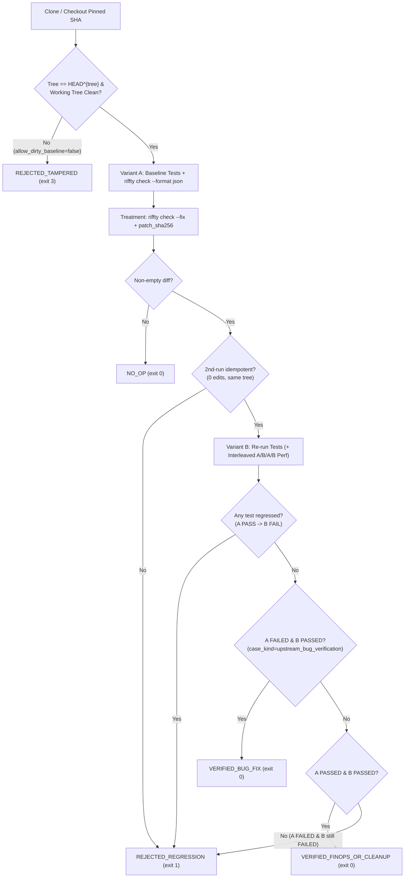

# RFC: `riffty-ab` — Deterministic A/B Empirical Verification Runner & Discovery CLI

- **Status:** In Progress — Milestones 0–1 Complete (13/13 Requirements, 4/4 OSS Scenarios PASS)
- **Target Repo:** `riffty` (`riffty-sh/riffty` — `crates/riffty_ab_core`, `apps/riffty_ab`)
- **Validation Repo:** `riffty-assets` (`benchmarks/ab_runner_milestones/`)
- **Precedents:** [`RFC_JAVA_PLUGIN_ARCHITECTURE.md`](./RFC_JAVA_PLUGIN_ARCHITECTURE.md), [`RFC_JSTS_PLUGIN_ARCHITECTURE.md`](./RFC_JSTS_PLUGIN_ARCHITECTURE.md)
- **Last Updated:** 2026-11-21

---

## 1. Executive Summary & Motivation

`riffty` delivers deterministic, compiler-grade static analysis and surgical UTF-8 byte-offset auto-remediation across Python, Java, and JS/TS while preserving a strict **Zero-RCE** invariant in `riffty check` and `riffty mcp`. However, proving empirical value on real-world open-source and enterprise repositories—showing that `riffty check --fix` fixes a failing test (`VERIFIED_BUG_FIX`) or measurably improves latency/allocations/code hygiene with zero regressions (`VERIFIED_FINOPS_OR_CLEANUP`)—currently requires hand-written `reproduce.sh` bash scripts per case.

Manual bash harnesses suffer from four structural weaknesses:
1. **Duplicated boilerplate:** Every case re-implements shallow cloning, `riffty` binary discovery, dry-run checks, idempotency assertions, diff capture, and log parsing.
2. **Potemkin / fake-case risk:** Copying modified `baseline/` files over an upstream checkout makes it easy to accidentally conflate a synthetic probe with a genuine unmodified upstream bug.
3. **Weak test & performance comparability:** Relying solely on exit codes misses subtle test-level regressions (e.g., Test X flips `PASS -> FAIL` while Test Y flips `FAIL -> PASS`), and sequential A-then-B timing runs are skewed by CPU thermal throttling and background noise.
4. **Manual discovery:** Finding genuine, PR-worthy upstream issues across real repositories requires ad-hoc CLI invocations and manual filtering of vendored/generated files.

**`riffty-ab`** solves this as a **companion Rust CLI binary** (`apps/riffty_ab`) backed by a pure domain crate (`crates/riffty_ab_core`). It automates the entire empirical proof-of-value loop declaratively via an `ab-case.toml` manifest, enforces cryptographic baseline attestation (`git rev-parse HEAD^{tree}`), runs deterministic Variant A vs. Variant B comparisons (including interleaved A/B/A/B performance runs), and emits machine-verifiable artifacts (`ab_report.json`, `AB_REPORT.md`, and optional `PR_FOR_REVIEW.md`).

---

## 2. Architectural Trade-offs & Design Decisions

### 2.1 Security Boundary: Companion Binary (`riffty-ab`) vs. Core Subcommand vs. Dynamic Plugin

| Option | Core `riffty` Zero-RCE Preserved? | Process / Env Isolation | Distribution & DX | Verdict |
| :--- | :---: | :---: | :--- | :---: |
| **A. Subcommand on `riffty` (`riffty ab`)** | Weakened (execution code linked into `riffty` binary) | Shared binary surface with `riffty mcp` | Single binary | **Rejected** — violates hard Zero-RCE separation between analyzer and test runner |
| **B. Out-of-process dynamic plugin** | Yes | Good, but adds IPC/discovery complexity | Requires separate plugin packaging | **Deferred** — unnecessary complexity for a pure-Rust workspace tool |
| **C. Companion Rust binary (`apps/riffty_ab` + `crates/riffty_ab_core`)** | **100% Preserved** (`riffty` & `riffty_mcp` never link `riffty_ab_core`) | Explicit `--allow-exec`, sanitized env, per-command timeout, optional sandbox wrapper | Built in same Cargo workspace, zero runtime deps | **Selected** |

#### Hard Security Controls in `riffty-ab`
1. **Explicit `--allow-exec` Gate:** `riffty-ab run` refuses to execute any setup, test, or benchmark command from `ab-case.toml` unless `--allow-exec` is explicitly passed on the CLI. Without `--allow-exec`, it fails closed with exit code `4` (or validates the manifest & runs read-only analysis with `--plan-only`).
2. **Read-Only Discovery (`riffty-ab scan`):** Never executes target repository code, build scripts, or test runners—only invokes `git` (read-only) and `riffty check --format json`.
3. **Subprocess Hygiene:** Every executed command runs with:
   - Configurable hard timeout (`timeout_secs`, default `300s`; kills process group on expiry).
   - Sanitized environment: starts from a minimal allowlist (`PATH`, `HOME`, `TMPDIR`, `USER`, `LANG`, `LC_ALL`, `NO_COLOR`, `JAVA_HOME`, `VIRTUAL_ENV`) plus explicit `[env]` entries from the manifest—never leaking unrelated host secrets (`AWS_*`, `GITHUB_TOKEN`, `OPENAI_API_KEY`, etc.).
   - Optional sandbox wrapper (`--sandbox none|docker`, with `--sandbox-image `) so CI or security-sensitive environments can execute untrusted test suites inside a container (`docker run --rm --network=none ...`).
   - Isolated workspace directory (never mutates the caller's working repository).

### 2.2 Anti-Potemkin & Anti-Fake-Case Guarantees

1. **Cryptographic Tree Attestation (`allow_dirty_baseline = false` default):**
   - After cloning/checking out the pinned 40-character hex `commit_sha`, `riffty-ab` records:
     - `head_sha = git rev-parse HEAD` (must exactly equal `commit_sha`)
     - `baseline_tree_sha = git rev-parse HEAD^{tree}`
     - `status_porcelain = git status --porcelain` (must be empty)
   - If `status_porcelain` is non-empty, `HEAD != commit_sha`, or `baseline_tree_sha` mismatches an expected `pinned_tree_sha` (when configured), and `allow_dirty_baseline` is `false`, `riffty-ab` immediately aborts and emits **`REJECTED_TAMPERED`** (exit code `3`).
2. **Strict Case Classification (`case_kind`):**
   - `upstream_bug_verification` (default): Requires `allow_dirty_baseline = false` and an unmodified upstream SHA. Only this kind may emit `VERIFIED_BUG_FIX`.
   - `finops_or_cleanup`: Requires `allow_dirty_baseline = false` and an unmodified upstream SHA. Emits `VERIFIED_FINOPS_OR_CLEANUP` when tests stay green and `riffty` heals findings (and optional perf improves).
   - `feature_or_security_probe`: Explicitly for synthetic/staged probes (where `allow_dirty_baseline = true` may be used). **Never** allowed to emit `VERIFIED_BUG_FIX`—capped at `VERIFIED_PROBE` so synthetic tests can never masquerade as real upstream bug fixes.
3. **Vendored & Generated File Detection:**
   - Every file with diagnostics or edits is inspected for:
     - Path patterns: `vendor/`, `third_party/`, `node_modules/`, `dist/`, `build/`, `generated/`, `__generated__/`, `*.min.js`, `*.pb.*`, `*.generated.*`.
     - Header markers (first 25 lines): `@generated`, `DO NOT EDIT`, `Code generated by`, `AUTO-GENERATED`, `@ts-nocheck`.
   - `riffty-ab scan` excludes vendored/generated files by default (`--include-vendored` to inspect).
   - `riffty-ab run` records `vendored_or_generated_files` in `ab_report.json` and emits a prominent warning in `AB_REPORT.md` if any healed file is vendored/generated.
4. **Deterministic Treatment & Provenance Attestation:**
   - Treatment is applied **exclusively** by invoking `riffty check --fix --format json` (zero LLM or manual edits).
   - Immediately after Pass 1, `riffty-ab` captures the exact `git diff`, computes `patch_sha256 = SHA-256(unified_diff)`, records `riffty --version` and `AnalysisProvenance`, and runs Pass 2 (`riffty check --fix --format json`) to verify **idempotency** (`auto_healed_count == 0` and identical working tree diff hash).
   - If Pass 2 mutates any file, `idempotent = false` and the verdict downgrades to `REJECTED_REGRESSION`.

### 2.3 Test & Metric Parsing

| Parser | Target Ecosystems | Extracted Signal |
| :--- | :--- | :--- |
| **`junit_xml`** | `pytest --junitxml=...`, Maven Surefire (`target/surefire-reports/TEST-*.xml`), Gradle (`build/test-results/test/TEST-*.xml`), `vitest --reporter=junit`, `jest-junit` | `total`, `passed`, `failed`, `errors`, `skipped`, and a `BTreeMap<String, TestOutcome>` keyed by `classname::name` |
| **`tap`** | `node --test --test-reporter=tap`, `pytest-tap`, Perl/C TAP runners | TAP v13/v14 `ok`/`not ok` lines, plan `1..N`, `# SKIP`/`# TODO`, per-test outcome map |
| **`exit_code`** | Any custom command / syntax checker / compiler gate | Process exit code (`0` = pass, non-zero = fail), duration, truncated stdout/stderr |

**Test-Level Regression Detection:**
When per-test outcomes are available (`junit_xml` or `tap`), `riffty-ab` computes the set difference:
- `fixed_tests`: tests that were `FAIL`/`ERROR` in Variant A and became `PASS` in Variant B.
- `regressed_tests`: tests that were `PASS` in Variant A and became `FAIL`/`ERROR` in Variant B.
- **Any non-empty `regressed_tests` immediately triggers `REJECTED_REGRESSION`**, even if the aggregate pass count increased.

### 2.4 Interleaved A/B/A/B Performance & FinOps Benchmarking

To eliminate thermal throttling, JIT warmup skew, and background OS scheduling drift:
1. Materialize **two sibling git worktrees** from the attested checkout:
   - `worktree_a` (pristine `HEAD^{tree}`, Control)
   - `worktree_b` (pristine `HEAD^{tree}` + exact `riffty` patch verified against `patch_sha256`, Treatment)
   - Both run any one-time `setup_cmd` (e.g., `mvn test-compile`, `npm ci --ignore-scripts`) before timing begins.
2. Execute `warmup_runs` (default `1`) interleaved pairs `(A, B)` and discard their measurements.
3. Execute `measured_pairs` (default `5`) interleaved pairs `(A_i, B_i)` (alternating order `A->B`, `B->A` on odd/even pairs to eliminate order effects!).
4. Capture wall-clock `duration_ms` for every run, plus an optional custom numeric metric extracted from stdout via regex (`metric_regex`, e.g., `ops/s:\s*([0-9.]+)`) or JSON key (`metric_json_key`), with `higher_is_better: bool`.
5. Compute deterministic summary statistics for A and B: `min`, `median`, `mean`, `p95`, `stddev`, `delta_pct` (median B vs. median A), `paired_wins` (count of pairs where B beat A), and a deterministic Wilcoxon/sign-test `improved` flag.

### 2.5 Discovery Mode (`riffty-ab scan`)

`riffty-ab scan` discovers genuine, PR-worthy upstream targets in **100% read-only (Zero-RCE)** mode:
1. Accepts a local git repo path or remote `--repo <url>` (cloned shallowly into a temp/cache dir) and optional `--commits N` (default `1` = `HEAD`, or walks last `N` commits).
2. Runs `riffty check --format json` (with optional `--rules <path>` and `--require-tier2`).
3. Filters out vendored/generated files (unless `--include-vendored`).
4. Ranks candidate files & rules by:
   - Safe auto-fixable findings (`applicability == "Safe"`) > `ManualOnly`
   - High severity (`Error` > `Warning`)
   - Clean, focused blast radius (small number of files for clean upstream PRs)
5. Auto-detects the repo's likely test runner (read-only inspection of `pyproject.toml`/`pytest.ini`, `package.json`, `pom.xml`, `build.gradle*`) and, when `--emit-manifest <path>` is passed, writes a ready-to-run `ab-case.toml` pinned to the exact `commit_sha` and `baseline_tree_sha` (`allow_dirty_baseline = false`).

### 2.6 Deterministic Verdict State Machine



---

## 3. System Architecture & Crate Topology

```text
riffty/
├── crates/
│   └── riffty_ab_core/              # Pure domain & logic crate (ZERO process execution!)
│       └── src/
│           ├── lib.rs
│           ├── manifest.rs          # AbManifest (ab-case.toml) schema & validation
│           ├── verdict.rs           # Verdict enum, comparator, anti-tamper & regression rules
│           ├── parsers/
│           │   ├── mod.rs
│           │   ├── junit.rs         # JUnit XML parser (pytest, Maven Surefire, Gradle, Vitest)
│           │   └── tap.rs           # TAP v13/v14 parser (node --test, etc.)
│           ├── stats.rs             # Interleaved A/B/A/B statistics (median, p95, stddev, delta_pct)
│           ├── vendored.rs          # Vendored / generated file path & header detector
│           ├── scanner.rs           # Discovery ranking & manifest generator
│           └── report.rs            # ab_report.json, AB_REPORT.md, PR_FOR_REVIEW.md renderers
└── apps/
    └── riffty_ab/                   # Companion CLI binary (explicit --allow-exec boundary)
        └── src/
            ├── main.rs              # clap CLI: run, scan, verify-report, init
            ├── git_ops.rs           # Clone, checkout pinned SHA, tree attestation, sibling worktrees
            ├── executor.rs          # Timeout, sanitized env, optional docker sandbox runner
            ├── riffty_invoker.rs    # Locate & run `riffty check`, parse JSON + provenance
            ├── runner.rs            # End-to-end A/B orchestrator
            └── scan_cmd.rs          # Read-only discovery command
```

### `ab-case.toml` Declarative Manifest Schema

```toml
schema_version = 1
case_id = "langchainjs-jsts-clone-cleanup"
case_kind = "finops_or_cleanup" # "upstream_bug_verification" | "finops_or_cleanup" | "feature_or_security_probe"

[repo]
url = "https://github.com/langchain-ai/langchainjs"
commit_sha = "a13bdc05aa23c7fce32ad1bd7033d33f84158397"
# Optional: expected `git rev-parse HEAD^{tree}` for double attestation
# tree_sha = "..."
# Optional: sparse checkout paths for large monorepos
sparse_paths = []
allow_dirty_baseline = false

[riffty]
# Paths relative to repo root to analyze/fix (default: ["."])
target_paths = ["libs/langchain-core/src/utils/fast-json-patch/src/helpers.ts"]
# Optional custom YAML Refaster rules (relative to manifest dir)
# rules = "../../../rules/python/utc_datetime_timezone_aware.yml"
unsafe_fixes = false
require_tier2 = false
extra_args = []

[test]
# Optional one-time setup command run after checkout (before Variant A & B)
# setup_cmd = "npm ci --ignore-scripts"
command = "node --experimental-transform-types --test test/helpers.test.ts"
parser = "tap" # "junit_xml" | "tap" | "exit_code"
# Required when parser = "junit_xml": path (relative to worktree) or glob
# report_path = "junit.xml"
timeout_secs = 300
env = {}

[perf]
enabled = false
command = ""
warmup_runs = 1
measured_pairs = 5
timeout_secs = 120
# Optional custom metric extraction (defaults to wall-clock duration_ms, lower is better)
# metric_name = "duration_ms"
# metric_regex = "ops/s:\\s*([0-9.]+)"
# higher_is_better = false
```

### Integration with `riffty-assets`
- Core engine & CLI live strictly in `riffty/` (`crates/riffty_ab_core` + `apps/riffty_ab`).
- External OSS validation cases, `ab-case.toml` manifests, `ab_report.json`, `AB_REPORT.md`, and `PR_FOR_REVIEW.md` live in `riffty-assets/benchmarks/ab_runner_milestones/case-NN-<slug>/` per `riffty-assets/AGENTS.md`.
- Existing `reproduce.sh` scripts remain 100% compatible and can incrementally migrate to a 3-line wrapper invoking `riffty-ab run ab-case.toml --allow-exec --out-dir logs/`.

---

## 4. Mandatory 5-Step Milestone Gate Protocol

**Every milestone (M0, M1, M2, M3) MUST pass all 5 steps in strict order before advancing:**

1. **Step A — 100% Deterministic Requirements Checklist Audit:**
   - Verify every `REQ-Mx-NN` item via executed commands/tests (`cargo test --workspace`, `cargo clippy --workspace --all-targets -- -D warnings`, CLI invocations, tamper/regression negative tests). Zero assumptions; no `[x]` without observed passing output.
2. **Step B — Parallel Real-Life OSS Validation Scenarios (1 Subagent per Scenario):**
   - Execute each milestone's real-life OSS validation scenarios in parallel (`invoke_subagent`) using `riffty-ab` itself on **100% unmodified upstream SHAs (`allow_dirty_baseline = false`) — zero synthetic/staged bugs allowed for bug-fix or cleanup claims**.
3. **Step C — Security, Tamper, Regression & Idempotency Verification:**
   - Explicitly verify:
     - Dirty baseline rejected (`REJECTED_TAMPERED`, exit 3).
     - Missing `--allow-exec` rejected (fail-closed, exit 4).
     - Test regression (`PASS -> FAIL`) rejected (`REJECTED_REGRESSION`, exit 1).
     - 2nd-run idempotency verified (`auto_healed_count == 0`, identical `patch_sha256`).
4. **Step D — Reports, Index & CI Wiring:**
   - Update `riffty-assets/benchmarks/ab_runner_milestones/AB_MILESTONES_REPORT.md`, `riffty-assets/README.md`, and `riffty-assets/.github/workflows/benchmarks.yml` with portable links only.
5. **Step E — Clean Git Status, Commit & Push:**
   - Verify clean `git status` in both `riffty/` and `riffty-assets/` (no `repo/`, `target/`, `node_modules/`, `.venv/`, worktrees).
   - Commit with a detailed milestone summary and push both `riffty/` and `riffty-assets/` before starting the next milestone.

---

## 5. Phased Implementation Plan & Verifiable Milestones

### Milestone 0 — Core Manifest, Git Attestation, Tamper Guard & Vendored File Detection
**Goal:** Establish `crates/riffty_ab_core` and `apps/riffty_ab` with strict manifest validation, cryptographic `HEAD^{tree}` attestation, vendored/generated file detection, and the `--allow-exec` security boundary, with zero regressions on `riffty`.

#### Milestone 0 Requirements & Verification Checklist
- [x] `REQ-M0-01`: Workspace members `crates/riffty_ab_core` and `apps/riffty_ab` added to `riffty/Cargo.toml`; `riffty_cli` and `riffty_mcp` have **zero** dependency on `riffty_ab_core` or `riffty_ab` (Zero-RCE boundary preserved). *Verify:* `cargo tree -p riffty_cli -p riffty_mcp | grep riffty_ab` returns empty.
- [x] `REQ-M0-02`: `AbManifest` (`ab-case.toml`) parses & validates `schema_version`, 40-hex `commit_sha`, `case_kind`, `allow_dirty_baseline` (defaults `false`), `[riffty]`, `[test]`, and `[perf]`, rejecting invalid SHAs or `upstream_bug_verification` with `allow_dirty_baseline = true`. *Verify:* `cargo test -p riffty_ab_core manifest`.
- [x] `REQ-M0-03`: Git attestation engine (`git_ops.rs`) clones/checks out pinned SHA, records `head_sha` & `baseline_tree_sha = git rev-parse HEAD^{tree}`, and detects dirty/staged/untracked files or tree-hash mismatch -> `REJECTED_TAMPERED` (exit code `3`). *Verify:* unit + integration tests with clean and tampered temp git repos.
- [x] `REQ-M0-04`: Vendored & generated file detector (`vendored.rs`) accurately flags `vendor/`, `third_party/`, `node_modules/`, `dist/`, `*.min.js`, `@generated`, `DO NOT EDIT`, `Code generated by`, and `@ts-nocheck` while not flagging normal source files. *Verify:* `cargo test -p riffty_ab_core vendored`.
- [x] `REQ-M0-05`: `--allow-exec` security gate & `riffty-ab init` / `riffty-ab run --plan-only`: running `riffty-ab run` without `--allow-exec` refuses to execute any manifest command and exits `4`; `--plan-only` validates manifest and prints execution plan without executing commands. *Verify:* CLI integration tests in `apps/riffty_ab`.
- [x] `REQ-M0-06`: Full `cargo test --workspace` and `cargo clippy --workspace --all-targets -- -D warnings` pass 100% with zero regressions.

#### Milestone 0 Real-Life OSS Validation Scenarios (Unmodified Upstream SHAs, `allow_dirty_baseline = false`)
1. **Scenario M0.1 (Python Upstream Attestation + Tamper Rejection):** `pallets/flask` (pinned unmodified upstream SHA) — verify `riffty-ab run --plan-only` + clean `HEAD^{tree}` attestation succeeds, and tampering a single byte in the checkout triggers `REJECTED_TAMPERED` (exit `3`).
2. **Scenario M0.2 (JS/TS Upstream Attestation + Vendored Detection):** `langchain-ai/langchainjs` (pinned unmodified upstream SHA `a13bdc05aa23c7fce32ad1bd7033d33f84158397`) — verify clean `HEAD^{tree}` attestation and vendored/generated classification accuracy.

---

### Milestone 1 — Deterministic A/B Execution, Test Parsers (JUnit XML / TAP / Exit Code), Idempotency & Comparator
**Goal:** Deliver the complete end-to-end `riffty-ab run --allow-exec` pipeline: Variant A baseline -> deterministic `riffty check --fix` + `patch_sha256` + 2nd-run idempotency -> Variant B healed -> JUnit XML/TAP/exit-code comparator -> machine-verifiable verdict (`VERIFIED_BUG_FIX`, `VERIFIED_FINOPS_OR_CLEANUP`, `REJECTED_REGRESSION`, `REJECTED_TAMPERED`, `NO_OP`) and report artifacts (`ab_report.json`, `AB_REPORT.md`, `PR_FOR_REVIEW.md`).

#### Milestone 1 Requirements & Verification Checklist
- [x] `REQ-M1-01`: JUnit XML parser (`parsers/junit.rs`) parses single and multi-file `<testsuite>`/`<testsuites>` XML from `pytest`, Maven Surefire, Gradle, and Vitest, extracting counts and per-test `classname::name -> Outcome` map. *Verify:* `cargo test -p riffty_ab_core junit`.
- [x] `REQ-M1-02`: TAP v13/v14 parser (`parsers/tap.rs`) parses `node --test --test-reporter=tap` output including subtests, `# SKIP`, `# TODO`, `ok`/`not ok`, and plan lines. *Verify:* `cargo test -p riffty_ab_core tap`.
- [x] `REQ-M1-03`: Sandboxed subprocess executor (`executor.rs`) enforces `timeout_secs` (kills hung child process), clears host env to safe allowlist + manifest `[env]`, and supports `--sandbox none|docker`. *Verify:* timeout & env-isolation integration tests.
- [x] `REQ-M1-04`: Deterministic treatment & idempotency engine (`riffty_invoker.rs` + `runner.rs`): runs baseline `riffty check --format json`, applies `riffty check --fix --format json`, captures exact unified diff + `patch_sha256` + `AnalysisProvenance`, and runs Pass 2 verifying `auto_healed_count == 0` and identical diff hash. *Verify:* integration test proving idempotency and non-idempotent failure detection.
- [x] `REQ-M1-05`: Deterministic verdict comparator (`verdict.rs`) accurately produces all 5 verdicts (`VERIFIED_BUG_FIX`, `VERIFIED_FINOPS_OR_CLEANUP`, `REJECTED_REGRESSION`, `REJECTED_TAMPERED`, `NO_OP`) and catches test-level regressions (`PASS -> FAIL` on individual test case even when aggregate failure count drops). *Verify:* exhaustive unit + E2E matrix tests covering all 5 verdicts.
- [x] `REQ-M1-06`: Artifact renderers (`report.rs`) emit schema-versioned `ab_report.json`, portable-link `AB_REPORT.md`, and optional `--emit-pr-review` `PR_FOR_REVIEW.md`. *Verify:* snapshot/schema validation tests.
- [x] `REQ-M1-07`: Full `cargo test --workspace` and `cargo clippy --workspace --all-targets -- -D warnings` pass 100%.

#### Milestone 1 Real-Life OSS Validation Scenarios (Unmodified Upstream SHAs, `allow_dirty_baseline = false`)
1. **Scenario M1.1 (JS/TS Upstream A/B Verification with TAP Parser):** `langchain-ai/langchainjs` (unmodified upstream SHA `a13bdc05aa23c7fce32ad1bd7033d33f84158397`, `JSTS-CLONE-001` in `helpers.ts`) — run `riffty-ab run --allow-exec` end-to-end with `node --test --test-reporter=tap`, verify `VERIFIED_FINOPS_OR_CLEANUP` (or `NO_OP` on clean file), `patch_sha256`, 2nd-run idempotency, `ab_report.json`, and `AB_REPORT.md`.
2. **Scenario M1.2 (Python Upstream A/B Verification with JUnit XML Parser):** Real unmodified Python OSS repo with genuine `riffty` findings + `pytest --junitxml=...` — run `riffty-ab run --allow-exec`, verify JUnit XML parsing, deterministic `riffty check --fix`, 2nd-run idempotency, and clean verdict.
3. **Scenario M1.3 (Negative Gate: Regression & Tamper Detection):** Verified E2E test demonstrating `REJECTED_REGRESSION` (exit `1`) when a test flips `PASS -> FAIL` and `REJECTED_TAMPERED` (exit `3`) when baseline is modified.

---

### Milestone 2 — Interleaved A/B/A/B Perf/FinOps Benchmarking & Read-Only Discovery Scanner (`riffty-ab scan`)
**Goal:** Add statistically sound interleaved A/B/A/B benchmarking using sibling git worktrees, read-only upstream discovery (`riffty-ab scan`) with automatic `ab-case.toml` generation, and offline report verification (`riffty-ab verify-report`).

#### Milestone 2 Requirements & Verification Checklist
- [ ] `REQ-M2-01`: Sibling git worktree manager creates `worktree_a` (pristine `HEAD^{tree}`) and `worktree_b` (attested `patch_sha256` applied), runs warmup pairs, and executes alternating interleaved `(A, B)` / `(B, A)` pairs. *Verify:* integration test verifying worktree isolation, alternating order, and automatic cleanup.
- [ ] `REQ-M2-02`: Statistics engine (`stats.rs`) computes `min`, `median`, `mean`, `p95`, `stddev`, `delta_pct`, and `paired_wins` across wall-clock `duration_ms` and optional regex/JSON stdout metric extractors (supporting both `higher_is_better = false` and `true`). *Verify:* deterministic unit tests with known distributions.
- [ ] `REQ-M2-03`: Read-only discovery scanner (`riffty-ab scan`) scans a target repo's `HEAD` (or `--commits N` history) using `riffty check --format json` with **zero target code execution**, filters vendored/generated files by default, ranks safe-fixable findings, and emits a valid `ab-case.toml` (`--emit-manifest`) with auto-detected test runner. *Verify:* CLI integration tests on multi-language fixture repos.
- [ ] `REQ-M2-04`: `riffty-ab verify-report <ab_report.json>` re-verifies internal consistency (`patch_sha256` matches embedded/linked diff, verdict matches variant A/B data, `allow_dirty_baseline` policy respected) and exits non-zero if a report was hand-edited/forged. *Verify:* positive + forged-report negative tests.
- [ ] `REQ-M2-05`: Full `cargo test --workspace` and `cargo clippy --workspace --all-targets -- -D warnings` pass 100%.

#### Milestone 2 Real-Life OSS Validation Scenarios (Unmodified Upstream SHAs, `allow_dirty_baseline = false`)
1. **Scenario M2.1 (Read-Only Discovery + Auto-Manifest on Python OSS Repo):** Run `riffty-ab scan` on a real unmodified Python OSS repo -> auto-generate `ab-case.toml` -> run `riffty-ab run --allow-exec` -> verify `riffty-ab verify-report` passes.
2. **Scenario M2.2 (Interleaved A/B/A/B Perf Benchmark on JS/TS OSS Repo):** Run `riffty-ab run --allow-exec` with `[perf] enabled = true` (interleaved A/B/A/B warmup + 5 pairs) on a real unmodified JS/TS repo (e.g., `langchain-ai/langchainjs` `JSTS-CLONE-001` or `JSTS-REGEX-LOOP-001` hot loop) -> verify `median`, `p95`, `delta_pct`, and `paired_wins` in `ab_report.json` and `AB_REPORT.md`.

---

### Milestone 3 — Multi-Language Real-World OSS E2E Validation (Python, Java, JS/TS) & CI Integration
**Goal:** Prove `riffty-ab` end-to-end across all three `riffty` languages (Python, Java, JS/TS) on 100% unmodified upstream SHAs (`allow_dirty_baseline = false`), emit `PR_FOR_REVIEW.md` packs, integrate with `riffty-assets` CI, and verify zero regressions across the entire workspace.

#### Milestone 3 Requirements & Verification Checklist
- [ ] `REQ-M3-01`: Real-world **Python** OSS E2E validation via `riffty-ab run --allow-exec --emit-pr-review` on an unmodified upstream SHA (`allow_dirty_baseline = false`) with `pytest` JUnit XML parsing, verified by `riffty-ab verify-report`.
- [ ] `REQ-M3-02`: Real-world **Java** OSS E2E validation via `riffty-ab run --allow-exec --emit-pr-review` on an unmodified upstream SHA (`allow_dirty_baseline = false`) with Maven/Gradle Surefire JUnit XML parsing, verified by `riffty-ab verify-report`.
- [ ] `REQ-M3-03`: Real-world **JS/TS** OSS E2E validation via `riffty-ab run --allow-exec --emit-pr-review` on an unmodified upstream SHA (`allow_dirty_baseline = false`) with TAP or JUnit XML parsing + interleaved perf A/B/A/B, verified by `riffty-ab verify-report`.
- [ ] `REQ-M3-04`: `riffty-assets/benchmarks/ab_runner_milestones/` contains `AB_MILESTONES_REPORT.md`, `README.md`, and per-case `ab-case.toml`, `ab_report.json`, `AB_REPORT.md`, `PR_FOR_REVIEW.md` (with zero `repo/`, `.venv/`, `node_modules/`, `target/` committed).
- [ ] `REQ-M3-05`: `riffty-assets/README.md` and `riffty-assets/.github/workflows/benchmarks.yml` updated to register the `riffty-ab` suite and validate manifests/reports in CI.
- [ ] `REQ-M3-06`: Final full-workspace gate: `RUSTFLAGS="-D warnings" cargo test --workspace` and `cargo clippy --workspace --all-targets -- -D warnings` 100% green, and both `riffty/` and `riffty-assets/` cleanly committed and pushed.
