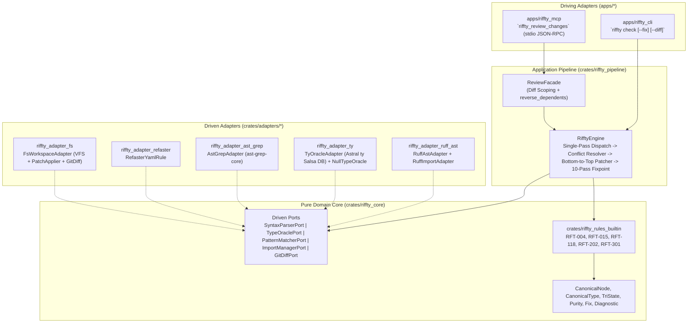

# `riffty` (v0.3) — Developer & Stakeholder Living Onboarding Guide

## 1. Mission & Strategic Scope
`riffty` is a deterministic, hexagonal (Ports & Adapters) multi-language software remediation and engineering-efficiency engine written in Rust, supporting **Python, Java, and JavaScript/TypeScript**, empirical A/B verification (`riffty-ab`), and infrastructure cost intelligence (`riffty_infra_core`).

### What `riffty` Solves
1. **Multi-Language Type-Aware Bug Detection & Fail-Closed Auto-Remediation**:
   - **Python (`riffty_rules_builtin`, `riffty_adapter_ruff_ast`, `riffty_adapter_ty`, `riffty_adapter_refaster`):** Catches high-confidence Python defects (`RFT-004`, `RFT-015`, `RFT-118`, `RFT-119`, `RFT-202`/`RFT-301`, `RFT-302`) and YAML Refaster rules guarded by Astral `ty` Salsa semantic queries.
   - **Java (`riffty_adapter_java_fast`, `riffty_adapter_plugin`, `plugins/riffty-java`):** Zero-JVM Tier 1 (`tree-sitter-java`) + Tier 2 semantic sidecar (JDK 25 `javac` `Trees`, Error Prone, Picnic, warm daemon, `[[java.architecture.forbid]]`).
   - **JS/TS (`riffty_adapter_jsts_fast`, `riffty_adapter_tsrs`):** Pure-Rust Tier 1 (`oxc`) + Tier 2 (`tsrs`) with zero Node.js runtime dependency and `[[jsts.architecture.forbid]]`.
2. **Surgical UTF-8 Byte-Offset Auto-Fixes & Lexical-Scope Import Healing**: Rewrites idioms via exact `TextRange` byte edits without AST pretty-printing, preserving 100% of surrounding and inline comments.
3. **Empirical A/B Verification (`riffty-ab`)**: Alternating `AB/BA` comparative benchmarking with exact Student-t 95% CI, p95/p99/max statistics, tamper guard, and SHA-256 evidence attestation.
4. **Infrastructure Efficiency & Cost Intelligence (`riffty infra`, `riffty efficiency`)**: Pure hexagonal core (`riffty_infra_core`) with offline `CoreOnly` and live `Connected` modes (native Rust HTTP adapters for Prometheus & OpenCost, Kubernetes HPA, public pricing).
5. **Zero-Token AI Diff Review (`riffty mcp`)**: Exposes `riffty_review_changes` over stdio JSON-RPC (`rmcp`), scoping analysis to `git diff` hunks plus cross-file `reverse_dependents` callers, healing `Safe` issues on disk, and returning a compact `APPROVED` / `REQUEST_CHANGES` verdict.

---

## 2. Hexagonal Architecture Overview



### Hard Architectural Invariants Audit
| Invariant | Verification Mechanism | Audit Status |
| :--- | :--- | :---: |
| **1. Zero Upstream Leakage into `riffty_core`** | `r01_riffty_core_cargo_toml_has_zero_upstream_leakage` asserts `crates/riffty_core/Cargo.toml` has zero `ruff_*`, `ty_*`, `ast_grep*`, or `salsa` deps | **VERIFIED** |
| **2. Byte-Offset Edits Only** | `apply_edits_bottom_to_top` + `RuffImportAdapter` emit UTF-8 `TextRange` slices only; zero AST codegen/unparsing | **VERIFIED** |
| **3. Zero-False-Positive Soundness** | `eval_is_subtype` & `r03_null_oracle_suppresses_type_dependent_rules_with_zero_false_positives` suppress diagnostics on `Unknown`/`Any` | **VERIFIED** |
| **4. Isolated Thin Driven Adapters** | Upstream `ruff_python_parser`, `ty_python_semantic`, `salsa`, `ast-grep-core`, and `rmcp` confined strictly to `crates/adapters/*` and `apps/riffty_mcp` | **VERIFIED** |

---

## 3. Developer Quickstart & Runbook

### Build & Run Verification Gates
```bash
# 1. Run all unit, conformance, golden SciPy #20068, and E2E CLI/MCP tests with zero warnings
RUSTFLAGS="-D warnings" cargo test --workspace

# 2. Run strict Clippy lint gate across all targets
cargo clippy --workspace --all-targets -- -D warnings

# 3. Run Boule 95% Affirmation Traceability Gate
node scripts/affirmation-tracer.mjs audit
```

### CLI Usage (`riffty check`)
```bash
# Check a Python project or file
cargo run -p riffty_cli -- check path/to/project

# Apply provably safe (`Applicability::Safe`) byte-offset fixes on disk
cargo run -p riffty_cli -- check --fix path/to/project

# Scope analysis to unstaged git diff + cross-file callers (`reverse_dependents`)
cargo run -p riffty_cli -- check --diff --fix path/to/project

# Evaluate additional Refaster declarative YAML rules (with optional venv `.pyi` stubs) and emit JSON
cargo run -p riffty_cli -- check --rules rules/default.yml --python-venv .venv --format json path/to/project
```

### MCP Reviewer Server Configuration (`Claude Code` / `Cursor` / `Codex`)
```json
{
  "mcpServers": {
    "riffty": {
      "command": "/path/to/riffty",
      "args": ["mcp", "--workspace", "/path/to/python-repo"]
    }
  }
}
```

---

## 4. Executive Acceptance Demos & Traceability Index
- **Architecture Specification**: [ach.md](file:///Users/jonatassouza/bin/dev/riffty_v2/docs/ach.md)
- **Domain Ontology & Policy Rules (`R01`–`R22`)**: [ontology.md](file:///Users/jonatassouza/bin/dev/riffty_v2/docs/ontology.md)
- **Affirmation Traceability Matrix (50/50 `VERIFIED_E2E`, >= 95% Gate)**: [affirmation-matrix.md](file:///Users/jonatassouza/bin/dev/riffty_v2/docs/affirmation-matrix.md)
- **User Stories (`US-001`–`US-007`)**: [user-stories.md](file:///Users/jonatassouza/bin/dev/riffty_v2/docs/user-stories.md)
- **Hexagonal Technical Tasks (`TASK-001`–`TASK-010`)**: [technical-tasks.md](file:///Users/jonatassouza/bin/dev/riffty_v2/docs/technical-tasks.md)
- **CLI & SciPy #20068 Acceptance Demo**: [demo-US-001-005-cli-remediation.md](file:///Users/jonatassouza/bin/dev/riffty_v2/docs/demos/demo-US-001-005-cli-remediation.md)
- **MCP `riffty_review_changes` Acceptance Demo**: [demo-US-006-mcp-review-changes.md](file:///Users/jonatassouza/bin/dev/riffty_v2/docs/demos/demo-US-006-mcp-review-changes.md)
- **v2.1 Open-World Soundness & 12-Scenario Postmortem Demo**: [demo-US-007-v2-1-soundness.md](file:///Users/jonatassouza/bin/dev/riffty_v2/docs/demos/demo-US-007-v2-1-soundness.md)

